<p align="center">
  <picture>
    <source media="(prefers-color-scheme: dark)" srcset="assets/peek-about-dark.svg">
    
  </picture>
</p>

<p align="center"><b>Ein schneller Bild- und Medienbetrachter für Windows 11.</b><br>
Keine Installation, keine Admin-Rechte, keine Internetverbindung.</p>

<p align="center"><a href="https://github.com/tn-023/peek/releases/latest">Download</a> · <a href="docs/CONCEPT.md">Technisches Konzept (englisch)</a></p>

<p align="center"><a href="README.md">English</a> | <b>Deutsch</b></p>

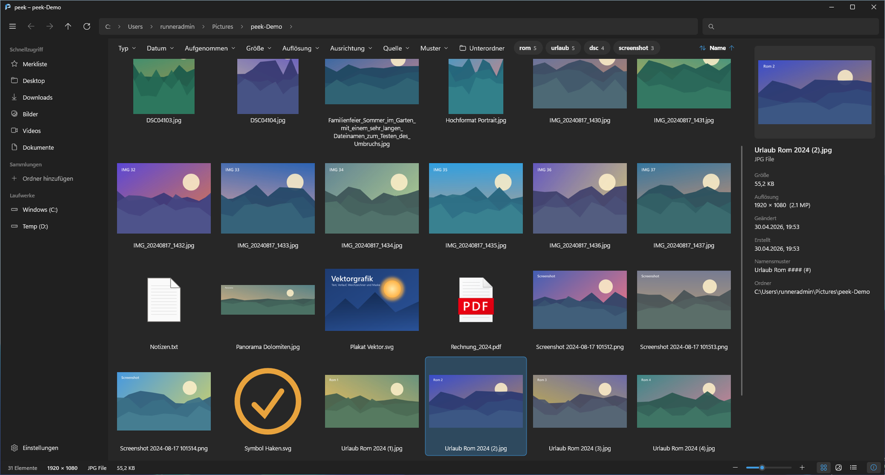

Ordner sofort sehen, Dateien schnell finden. peek erkennt Begriffe und Muster in Dateinamen und bietet sie als Filter an. Eine EXE, kein Konto, keine Cloud.

## Warum peek

- **Ruhige Oberfläche:** Keine Menüleiste, keine Werkzeugkästen.
- **Schnell:** C++20, GPU-beschleunigt. Vorschaubilder entstehen im Hintergrund.
- **Portabel und privat:** läuft vom USB-Stick, keine Netzwerkfunktionen. peek enthält keinen eigenen Netzwerkcode; eingebundene Netzlaufwerke liest Windows.
- **Abgeschottet:** Bilder, Videos und Dokumente werden in einer Sandbox dekodiert. Ohne Netzwerk, ohne Zugriff auf andere Dateien.
- **Kein Hintergrunddienst:** indexiert nur, solange peek läuft. Kein Dienst, kein Autostart.
- **Finden:** Begriffe als Pillen, Filter für Typ, Datum, Größe, Auflösung, Ausrichtung. Suche mit `Breite:>3000 Datum:2024-08`.
- **Mehr als Bilder:** Vorschau auch für SVG, TGA, Videos, PDF, Photoshop, Illustrator.
- **Werkzeuge:** Bilder vergleichen, Zuschneiden, Kontaktabzug als PDF, Kacheltextur aus PNG-Sequenzen.
- **Deutsch und Englisch:** folgt der Windows-Sprache, umschaltbar in den Einstellungen.
- **Windows 11:** Mica, Hell/Dunkel, Textskalierung, volle Tastaturbedienung.

## Finden statt suchen

### Erkannte Begriffe

peek erkennt Muster in Dateinamen und schlägt diese Begriffe als Filter vor, mit Trefferzahl.

| Dateiname | erkannte Begriffe |
| --- | --- |
| `Urlaub Rom 2024 (3).jpg` | `urlaub`, `rom` |
| `SommerUrlaub_Rom-2024.jpg` | `sommer`, `urlaub`, `rom` |
| `München_Straße.jpg` | `muenchen`, `strasse` |


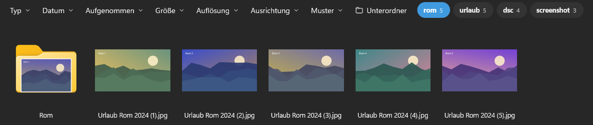

### Quelle und Muster

**Quelle** erkennt die Herkunft: Kamera, Drohne, Bildschirmfoto, Messenger. **Muster** gruppiert gleich aufgebaute Namen.

| Dateiname | Quelle | Muster |
| --- | --- | --- |
| `IMG_20240817_1430.jpg` | Kamera (IMG) | `IMG_{Datum}_####` |
| `Screenshot 2024-08-17 101500.png` | Bildschirmfoto | `Screenshot {Datum} ######` |
| `Urlaub Rom 2024 (3).jpg` | – | `Urlaub Rom #### (#)` |


<table>
  <tr>
    <td width="50%" valign="top" align="center">
      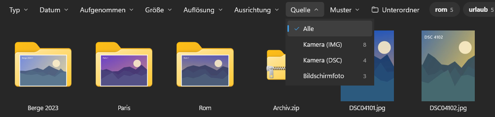<br>
      <sub>Quelle</sub>
    </td>
    <td width="50%" valign="top" align="center">
      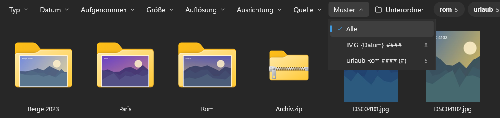<br>
      <sub>Muster</sub>
    </td>
  </tr>
</table>

### Zeitraum

Ein Kalender für Jahre, Monate, Tage bei Datum und Aufgenommen. Die Anzahl wird schon vorher angezeigt. Klick wählt, Ziehen wählt einen Zeitraum.

<p align="center">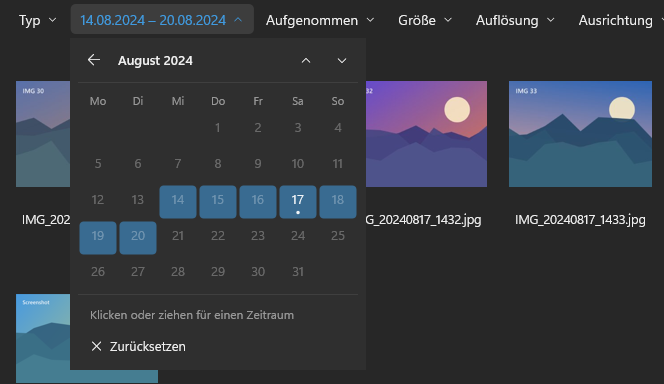</p>

### Suche

Einfach lostippen. Parameter grenzen ein. Ein Klick ins Suchfeld zeigt Vorschläge.

| Eingabe | Bedeutung |
| --- | --- |
| `rom urlaub` · `"hochzeit anna"` · `-screenshot` · `urlaub*` | Begriffe, Phrase, ausschließen, Platzhalter |
| `Breite:>3000` · `Höhe:>2000` · `Megapixel:>=20` | Abmessungen |
| `Größe:>10mb` · `Dauer:>60s` | Dateigröße, Videodauer |
| `Datum:2024-08..2024-09` · `Aufgenommen:2024` | Zeitraum |
| `Endung:jpg,png` · `Typ:Video` · `Kamera:x-t5` | Endung, Typ, Kamera |

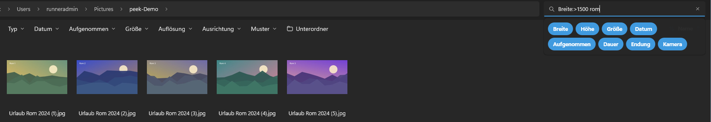

## Bilderwolke

Der Ordner als Wolke im Raum. Die Sortierung bestimmt, was oben liegt. Mausrad fährt hinein und hindurch. Klick holt ein Bild heran, zweiter Klick öffnet. Filter ordnen die Wolke neu.

<p align="center">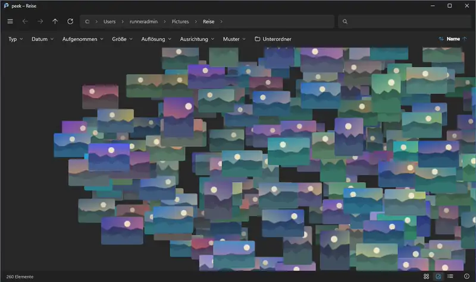</p>

<table>
  <tr>
    <td width="50%" valign="top" align="center">
      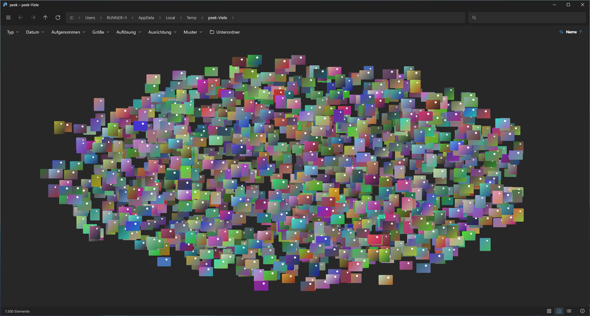<br>
      <sub>1.500 Bilder, GPU-beschleunigt</sub>
    </td>
    <td width="50%" valign="top" align="center">
      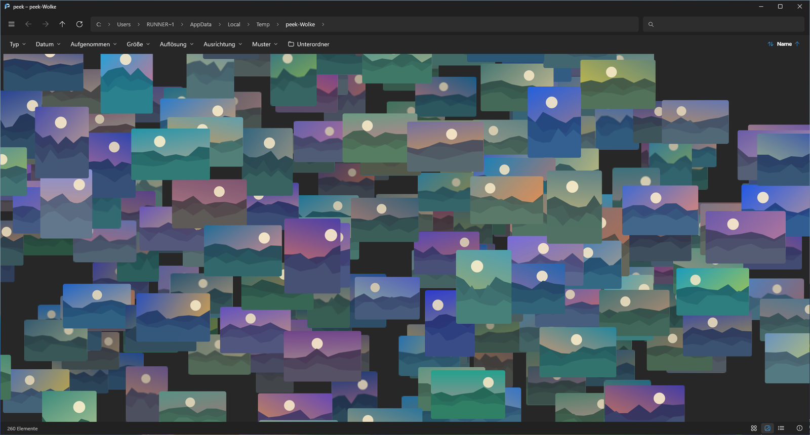<br>
      <sub>260 Bilder, aus der Nähe</sub>
    </td>
  </tr>
</table>

## Weitere Funktionen

<table>
  <tr>
    <td width="50%" valign="top" align="center">
      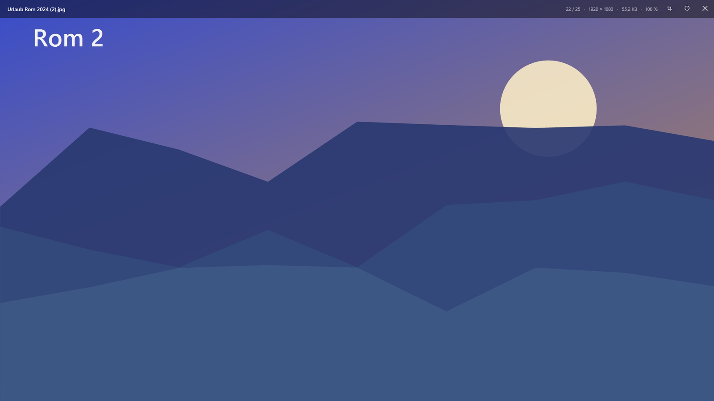<br>
      <sub>Bildbetrachter</sub><br><br>
      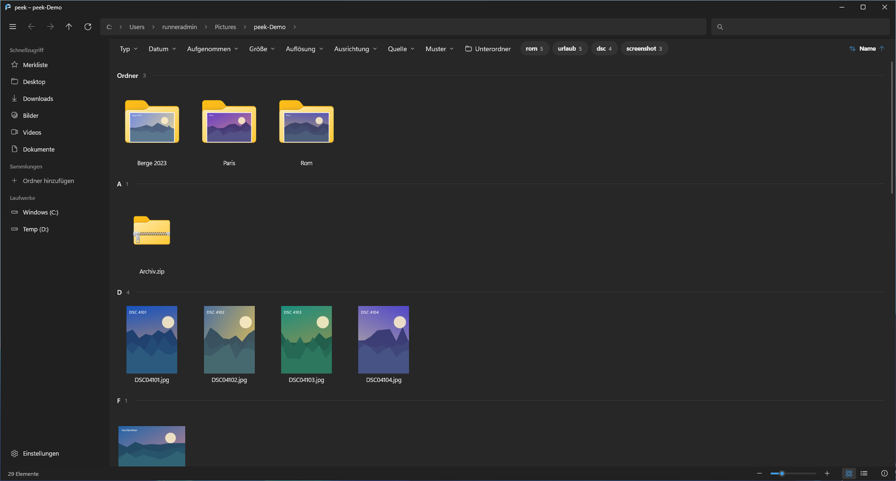<br>
      <sub>Gruppiert nach Datum, Größe …</sub><br><br>
      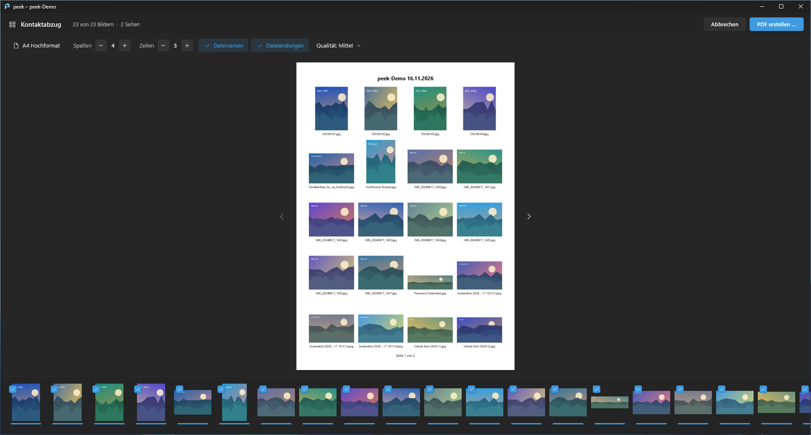<br>
      <sub>Kontaktabzug als PDF</sub><br><br>
      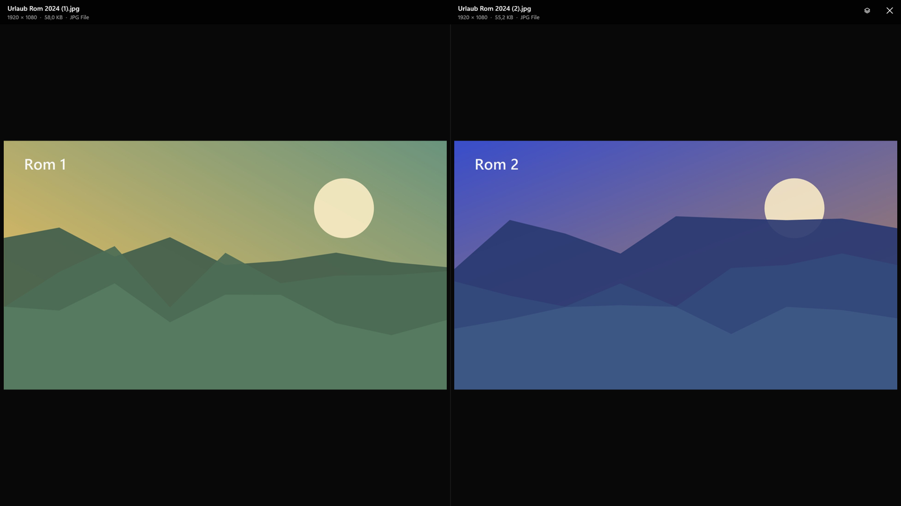<br>
      <sub>Vergleichen: nebeneinander</sub>
    </td>
    <td width="50%" valign="top" align="center">
      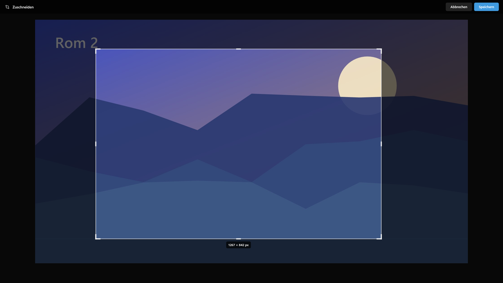<br>
      <sub>Zuschneiden</sub><br><br>
      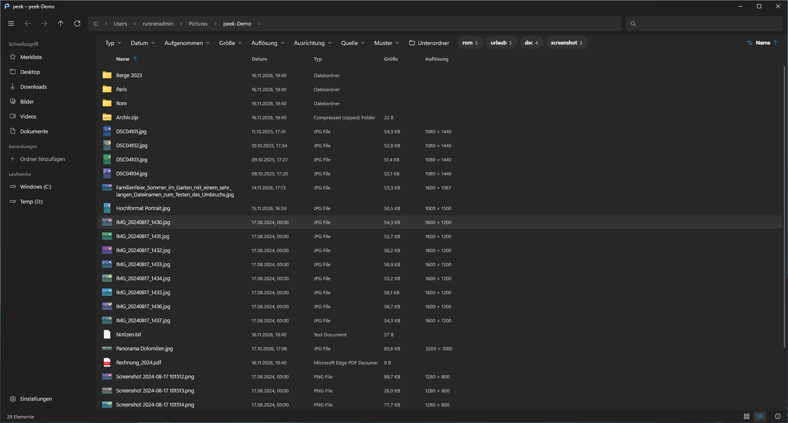<br>
      <sub>Listenansicht</sub><br><br>
      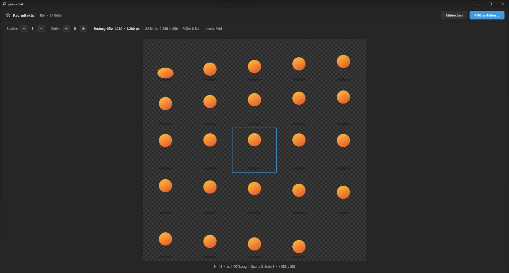<br>
      <sub>Kacheltextur, pixelgenau</sub><br><br>
      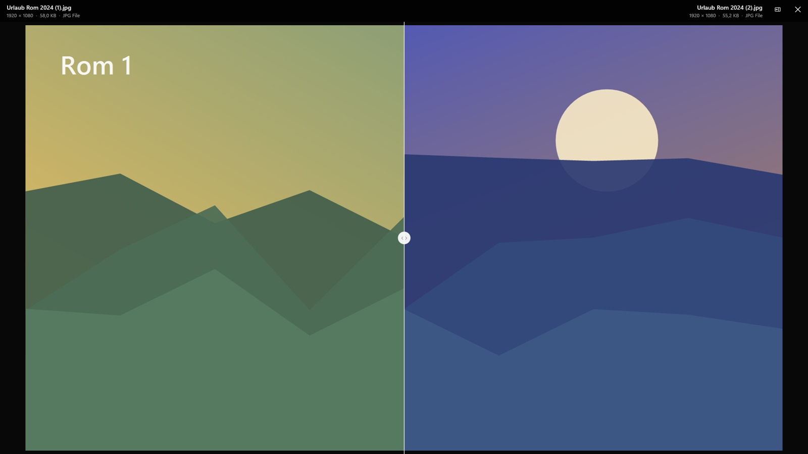<br>
      <sub>Vergleichen: übereinander mit Trennlinie</sub>
    </td>
  </tr>
</table>

## Herunterladen

1. Unter **[Releases](../../releases)** die neueste `peek.exe` herunterladen.
2. In einen Ordner legen (auch USB-Stick), starten. Nicht signiert: SmartScreen → **Weitere Informationen → Trotzdem ausführen**.

Lizenzhinweise der eingebundenen Bibliotheken: `THIRD-PARTY.txt` im Release.

Daten liegen in `%LOCALAPPDATA%\peek`. Mit einer leeren Datei `peek.portable` neben der EXE: in `peek-data\` daneben.

## Funktionen

- **Ansichten:** Kacheln, Liste, Bilderwolke. Vorschau für Bilder, SVG, Videos, PDF, PSD, AI.
- **Bildbetrachter:** JPEG, PNG, GIF, BMP, WebP, AVIF, TIFF, ICO, SVG, TGA. Zoom, Drehen, Zuschneiden. SVG bleibt in jeder Zoomstufe scharf.
- **Filter und Suche:** Begriffe, Quelle, Muster, Kalender, Suchparameter, Suchverlauf.
- **Merkliste und Sammlungen:** vormerken mit Stern, Ordner indexieren, solange peek läuft.
- **Vergleichen:** zwei Bilder nebeneinander, Zoom synchron. Oder übereinander mit Trennlinie am Mauszeiger.
- **Kontaktabzug:** A4 hoch/quer, Raster frei wählbar, Bilder per Ziehen sortieren. PDF mit eingebetteter Schrift.
- **Kacheltextur:** PNG-Sequenz zu einer PNG, pixelgenau. 8 und 16 Bit, Transparenz bleibt.
- **Dateien:** Umbenennen, Eigenschaften, Öffnen mit, Kopieren, Einfügen, Ziehen auf Ordner, Papierkorb.
- **Laufwerke:** lokale Laufwerke und eingebundene Netzlaufwerke (mit Laufwerksbuchstaben); nur online verfügbare Cloud-Dateien bekommen kein Vorschaubild.
- **Sandbox:** Dekoder laufen in AppContainer-Prozessen. Eine präparierte Datei kann weder ins Netz noch an andere Dateien.
- **Index verschlüsselt:** Pfade und Vorschaubilder nur verschlüsselt gespeichert, an das Windows-Konto gebunden. Gelöschtes verschwindet auch aus dem Index.

### Tastatur

Tippen sucht. `Enter` öffnet. `Leertaste` zeigt das Bild. `Alt+←/→/↑` navigiert. `F2` benennt um. `Alt+Enter` zeigt die Eigenschaften. `Entf` löscht in den Papierkorb. `Strg+1/2/3` wechselt die Ansicht. Alle Kürzel: **Einstellungen → Tastenkombinationen**.

## Bauen

Voraussetzungen: Visual Studio 2022 (C++-Workload), CMake ≥ 3.24, vcpkg, Rust (für den SVG-Renderer resvg).

```powershell
./tools/build-resvg.ps1          # einmalig: resvg nach deps/resvg
cmake -S . -B build -G Ninja -DCMAKE_BUILD_TYPE=Release `
  -DCMAKE_TOOLCHAIN_FILE="$env:VCPKG_ROOT/scripts/buildsystems/vcpkg.cmake" `
  -DVCPKG_TARGET_TRIPLET=x64-windows-static
cmake --build build
ctest --test-dir build
./tools/check-imports.ps1 -Exe build/peek.exe
```

Jeder Push auf `main` baut, testet und prüft: Die EXE darf keine Netzwerkbibliotheken importieren, und die Sandbox-Prüfung muss bestehen. Releases über den Workflow **release**.

## Aufbau

Details im [technischen Konzept](docs/CONCEPT.md) (englisch).

| Datei | Inhalt |
| --- | --- |
| `src/core/` | plattformunabhängig: Tokenizer, Namensmuster, Abfragesprache, Seitenberechnung des Kontaktabzugs, Aufteilung der Kacheltextur (mit Tests) |
| `src/renderer.*` · `src/popup.*` | Direct3D 11, Direct2D, DirectComposition, Mica · Menüs mit Untermenüs |
| `src/imaging.*` · `src/docimaging.*` · `src/svgimaging.*` | WIC, libwebp, libavif, Media Foundation · Vorschaubilder für PDF, AI und PSD · SVG mit resvg |
| `src/sandbox.*` · `src/fileinput.*` | Dekoder-Prozesse im AppContainer: Pool, Pipe, gemeinsamer Speicher · Lesen nur über übergebene Handles |
| `src/thumbs.*` · `src/meta.*` · `src/indexer.*` · `src/db.*` | Vorschaubilder, Metadaten, Hintergrund-Index, SQLite |
| `src/pdfsheet.*` · `src/contactsheet.cpp` | PDF-Schreiber · Kontaktabzug |
| `src/cloud.cpp` | Bilderwolke: Anordnung, Kamera, Ausweichen, Atlas und Sprite-Batches |
| `src/atlaswriter.*` · `src/atlas.cpp` | pixelgenaues Zusammensetzen der PNG-Sequenz · Kacheltextur |
| `src/app*.cpp` · `src/crop.cpp` · `src/datepicker.cpp` | Fenster, Ansicht, Eingabe, Bildbetrachter, Zuschneiden, Datums-Picker |
| `assets/` · `docs/` | Symbol und Logos · Release-Notes und Bildschirmfotos |

## Privates Projekt

peek ist ein privates Projekt, entstanden für den eigenen Gebrauch. Der Quelltext ist öffentlich, damit andere ihn ansehen und unter den unten genannten Lizenzen weiterverwenden können. Es gibt keine Unterstützung, keine Fehlerannahme und keine Aufnahme von Beiträgen (Issues und Pull Requests). Wer etwas ändern möchte, kann das Projekt gern forken.

## Lizenz

peek steht unter einer Doppellizenz. Wahlweise gilt:

- [MIT-Lizenz](LICENSE-MIT)
- [Apache-Lizenz 2.0](LICENSE-APACHE)

Die Lizenzen der eingebundenen Bibliotheken stehen in `THIRD-PARTY.txt`.
