<p align="center">
  <picture>
    <source media="(prefers-color-scheme: dark)" srcset="assets/peek-about-dark.svg">
    
  </picture>
</p>

<p align="center"><b>A fast image and media viewer for Windows 11.</b><br>
No installation, no admin rights, no internet connection.</p>

<p align="center"><a href="https://github.com/tn-023/peek/releases/latest">Download</a> · <a href="docs/CONCEPT.md">Technical concept</a></p>

<p align="center"><b>English</b> | <a href="README.de.md">Deutsch</a></p>

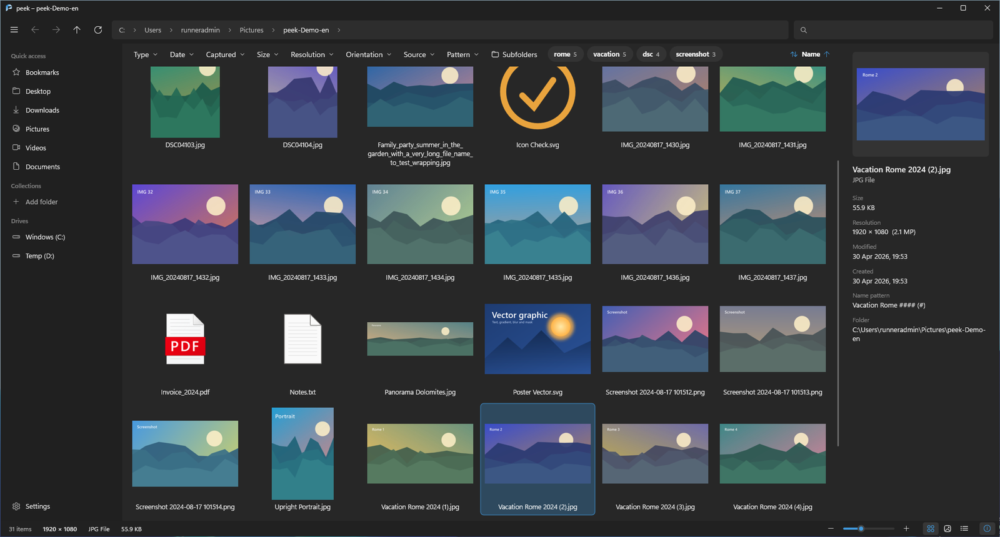

See a folder instantly, find files quickly. peek recognizes terms and patterns in file names and offers them as filters. One EXE, no account, no cloud.

## Why peek

- **Calm interface:** no menu bar, no toolboxes.
- **Fast:** C++20, GPU-accelerated. Thumbnails are created in the background.
- **Portable and private:** runs from a USB stick, no network features. peek contains no network code of its own; mapped network drives are read by Windows.
- **Isolated:** images, videos and documents are decoded in a sandbox, with no network and no access to other files.
- **No background service:** indexes only while peek is running. No service, no autostart.
- **Find:** terms as pills, filters for type, date, size, resolution, orientation. Search with `width:>3000 date:2024-08`.
- **More than images:** previews for SVG, TGA, videos, PDF, Photoshop, Illustrator.
- **Tools:** compare images, crop, slideshow, contact sheet as PDF, tile texture from PNG sequences.
- **English and German:** follows the Windows language, switchable in the settings.
- **Windows 11:** Mica, light/dark, text scaling, full keyboard control.

## Find instead of search

### Recognized terms

peek recognizes patterns in file names and suggests these terms as filters, with the number of matches.

| File name | recognized terms |
| --- | --- |
| `Vacation Rome 2024 (3).jpg` | `vacation`, `rome` |
| `SummerVacation_Rome-2024.jpg` | `summer`, `vacation`, `rome` |
| `München_Straße.jpg` | `muenchen`, `strasse` |


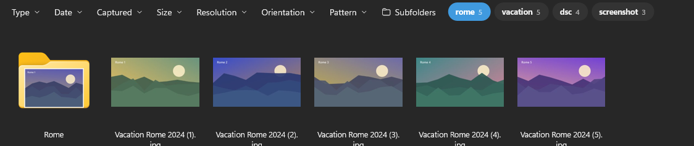

### Source and pattern

**Source** recognizes where a file came from: camera, drone, screenshot, messenger. **Pattern** groups names with the same structure.

| File name | Source | Pattern |
| --- | --- | --- |
| `IMG_20240817_1430.jpg` | Camera (IMG) | `IMG_{date}_####` |
| `Screenshot 2024-08-17 101500.png` | Screenshot | `Screenshot {date} ######` |
| `Vacation Rome 2024 (3).jpg` | – | `Vacation Rome #### (#)` |


<table>
  <tr>
    <td width="50%" valign="top" align="center">
      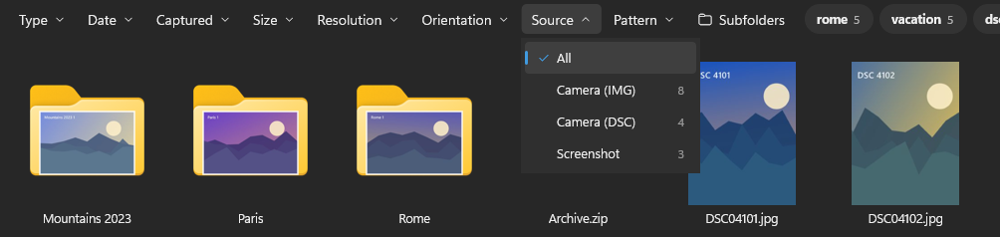<br>
      <sub>Source</sub>
    </td>
    <td width="50%" valign="top" align="center">
      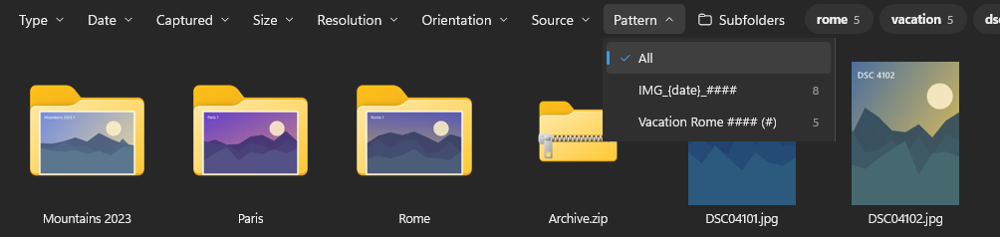<br>
      <sub>Pattern</sub>
    </td>
  </tr>
</table>

### Time range

A calendar for years, months and days, for both file date and capture date. The number of matches is shown in advance. Click selects, dragging selects a range.

<p align="center">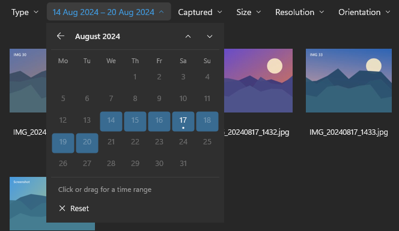</p>

### Search

Just start typing. Parameters narrow the results. Clicking the search field shows suggestions.

| Input | Meaning |
| --- | --- |
| `rome vacation` · `"wedding anna"` · `-screenshot` · `vacation*` | terms, phrase, exclude, wildcard |
| `width:>3000` · `height:>2000` · `megapixels:>=20` | dimensions |
| `size:>10mb` · `duration:>60s` | file size, video duration |
| `date:2024-08..2024-09` · `captured:2024` | file date, capture date |
| `extension:jpg,png` · `type:video` · `camera:x-t5` | extension, type, camera |

The German parameter names (`Breite:`, `Datum:` …) work as well, whatever the interface language.

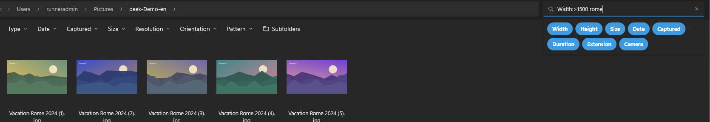

## Image cloud

The folder as a cloud in space. The sort order decides what is on top. The mouse wheel moves into and through the cloud. Click brings an image closer, a second click opens it. Filters rearrange the cloud.

<p align="center">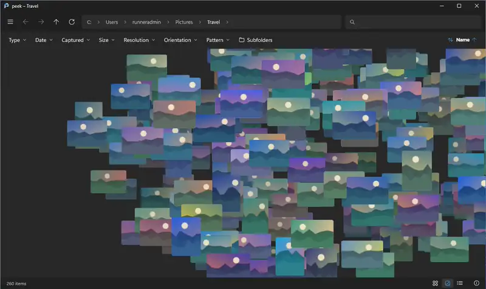</p>

<table>
  <tr>
    <td width="50%" valign="top" align="center">
      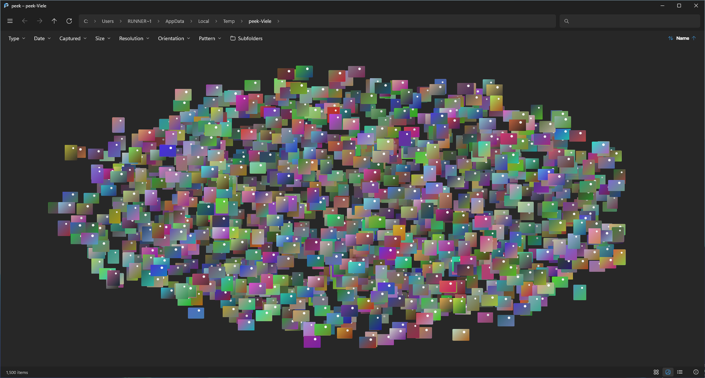<br>
      <sub>1,500 images, GPU-accelerated</sub>
    </td>
    <td width="50%" valign="top" align="center">
      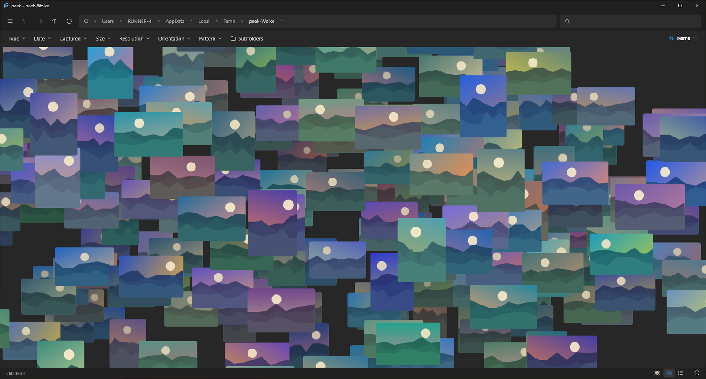<br>
      <sub>260 images, up close</sub>
    </td>
  </tr>
</table>

<p align="center">
  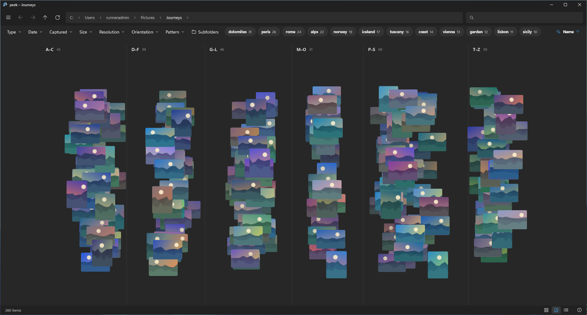<br>
  <sub>Grouping splits the cloud into up to six strips with title and count</sub>
</p>

## Timeline

All images and videos of a folder on a horizontal time axis, newest first (or oldest first). Grouped by day, month or year depending on how many there are; full years show their months, full months their days. Columns away from the center get smaller and darker. Drag or flick to move; the overview at the bottom shows how many images each period holds and where you are. A slideshow started here shows the date of each group as it begins.

<p align="center">
  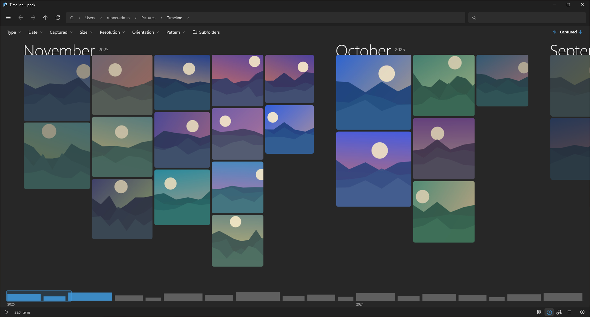<br>
  <sub>Timeline grouped by month, with the overview at the bottom</sub>
</p>

## More features

<table>
  <tr>
    <td width="50%" valign="top" align="center">
      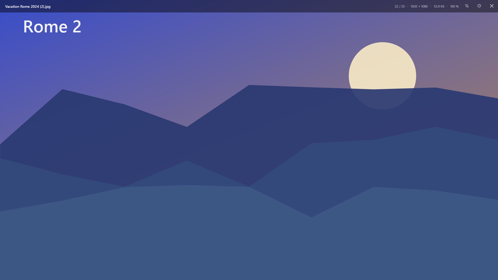<br>
      <sub>Image viewer</sub><br><br>
      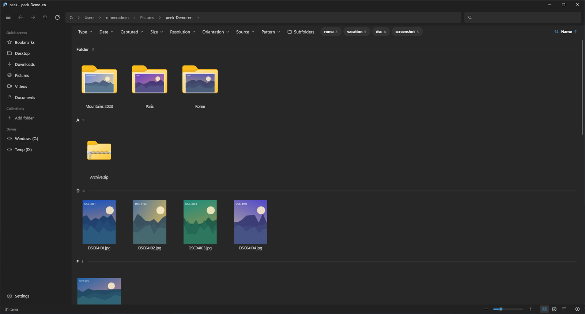<br>
      <sub>Grouped by date, size …</sub><br><br>
      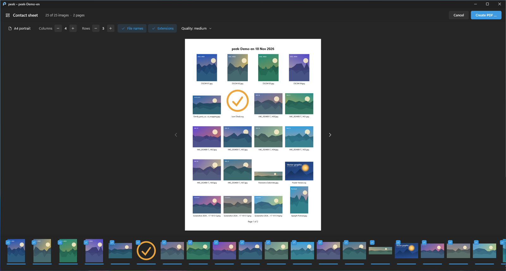<br>
      <sub>Contact sheet as PDF</sub><br><br>
      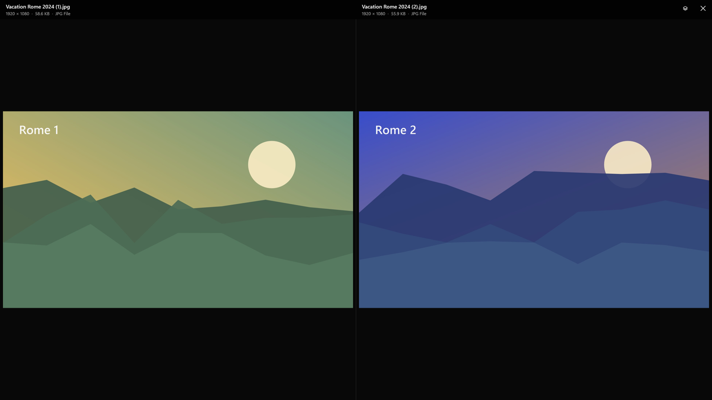<br>
      <sub>Compare: side by side</sub>
    </td>
    <td width="50%" valign="top" align="center">
      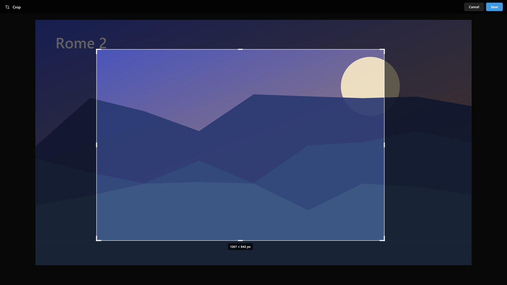<br>
      <sub>Crop</sub><br><br>
      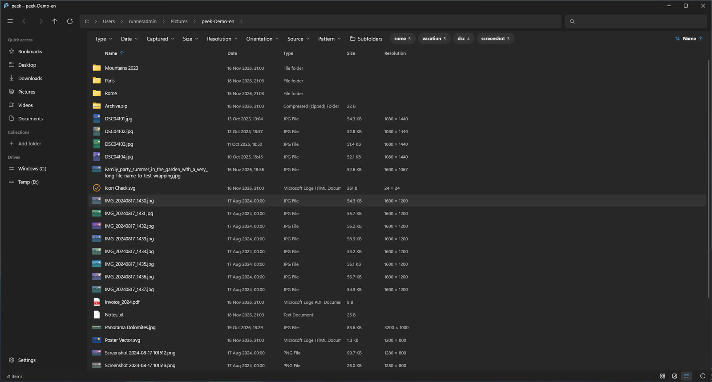<br>
      <sub>List view</sub><br><br>
      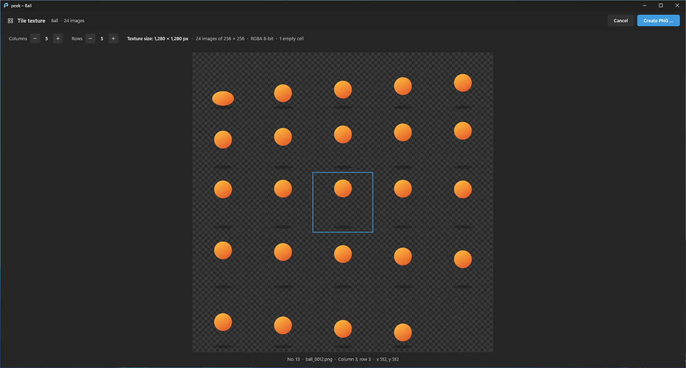<br>
      <sub>Tile texture, pixel-exact</sub><br><br>
      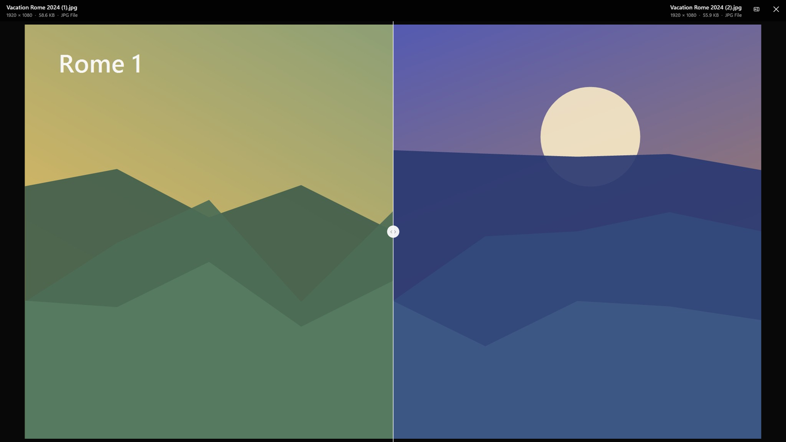<br>
      <sub>Compare: overlaid with a divider</sub>
    </td>
  </tr>
</table>

## Download

1. Download the latest `peek.exe` from **[Releases](../../releases)**.
2. Put it in a folder (a USB stick works too) and start it. It is not signed: SmartScreen → **More info → Run anyway**.

License notices for the bundled libraries: `THIRD-PARTY.txt` in the release.

Data is stored in `%LOCALAPPDATA%\peek`. With an empty file `peek.portable` next to the EXE, it is stored in `peek-data\` next to it instead.

## Features

- **Views:** tiles, list, image cloud, timeline. Previews for images, SVG, videos, PDF, PSD, AI.
- **Image viewer:** JPEG, PNG, GIF, BMP, WebP, AVIF, TIFF, ICO, SVG, TGA, HEIC/HEIF (requires Microsoft's free “HEIF Image Extensions” and the “HEVC Video Extensions” from the Store). Zoom, rotate, crop, slideshow with cross-fades. SVG stays sharp at every zoom level. Full screen or inside the peek window.
- **Filters and search:** terms, source, pattern, calendar, search parameters, search history.
- **Location:** GPS coordinates from the photos in the info panel; a click copies them or opens OpenStreetMap in the browser.
- **Bookmarks and collections:** mark with a star, index folders while peek is running.
- **Compare:** two images side by side with synchronized zoom, or overlaid with a divider at the mouse pointer.
- **Contact sheet:** A4 portrait/landscape, freely chosen grid, reorder images by dragging. PDF with embedded font.
- **Tile texture:** PNG sequence to a single PNG, pixel-exact. 8 and 16 bit, transparency preserved.
- **Files:** rename, properties, open with, copy, paste, drag onto folders or into the open folder (also between peek windows), recycle bin.
- **Drives:** local drives and mapped network drives (with a drive letter); online-only cloud files get no thumbnail.
- **Sandbox:** decoders run in AppContainer processes. A crafted file can reach neither the network nor other files.
- **Encrypted index:** paths and thumbnails are stored only in encrypted form, bound to the Windows account. Deleted files also disappear from the index.

### Keyboard

Typing searches. `Enter` opens. `Space` shows the image. `Alt+←/→/↑` navigates. `F2` renames. `Alt+Enter` shows properties. `Del` moves to the recycle bin. `Ctrl+1/2/3/4` switches the view. All shortcuts: **Settings → Keyboard shortcuts**.

## Building

Requirements: Visual Studio 2022 (C++ workload), CMake ≥ 3.24, vcpkg, Rust (for the SVG renderer resvg).

```powershell
./tools/build-resvg.ps1          # once: resvg into deps/resvg
cmake -S . -B build -G Ninja -DCMAKE_BUILD_TYPE=Release `
  -DCMAKE_TOOLCHAIN_FILE="$env:VCPKG_ROOT/scripts/buildsystems/vcpkg.cmake" `
  -DVCPKG_TARGET_TRIPLET=x64-windows-static
cmake --build build
ctest --test-dir build
./tools/check-imports.ps1 -Exe build/peek.exe
```

Every push to `main` builds, tests and checks: the EXE must not import any network libraries, and the sandbox check must pass. Releases are made with the **release** workflow.

## Structure

Details in the [technical concept](docs/CONCEPT.md). Source code comments are in German.

| File | Contents |
| --- | --- |
| `src/core/` | platform-independent: tokenizer, name patterns, query language, contact sheet page layout, tile texture splitting (with tests) |
| `src/renderer.*` · `src/popup.*` | Direct3D 11, Direct2D, DirectComposition, Mica · menus with submenus |
| `src/imaging.*` · `src/docimaging.*` · `src/svgimaging.*` | WIC, libwebp, libavif, Media Foundation · thumbnails for PDF, AI and PSD · SVG with resvg |
| `src/sandbox.*` · `src/fileinput.*` | decoder processes in an AppContainer: pool, pipe, shared memory · reading only via handed-over handles |
| `src/thumbs.*` · `src/meta.*` · `src/indexer.*` · `src/db.*` | thumbnails, metadata, background index, SQLite |
| `src/pdfsheet.*` · `src/contactsheet.cpp` | PDF writer · contact sheet |
| `src/cloud.cpp` | image cloud: layout, camera, avoidance, atlas and sprite batches |
| `src/atlaswriter.*` · `src/atlas.cpp` | pixel-exact assembly of the PNG sequence · tile texture |
| `src/app*.cpp` · `src/crop.cpp` · `src/datepicker.cpp` | window, view, input, image viewer, crop, date picker |
| `assets/` · `docs/` | icon and logos · release notes and screenshots |

## Private project

peek is a private project, made for personal use. The source code is public so that others can read it and reuse it under the licenses below. There is no support, no bug tracking and no acceptance of contributions (issues and pull requests). If you want to change something, feel free to fork the project.

## License

peek is dual-licensed. You may choose either:

- [MIT License](LICENSE-MIT)
- [Apache License 2.0](LICENSE-APACHE)

The licenses of the bundled libraries are listed in `THIRD-PARTY.txt`.
