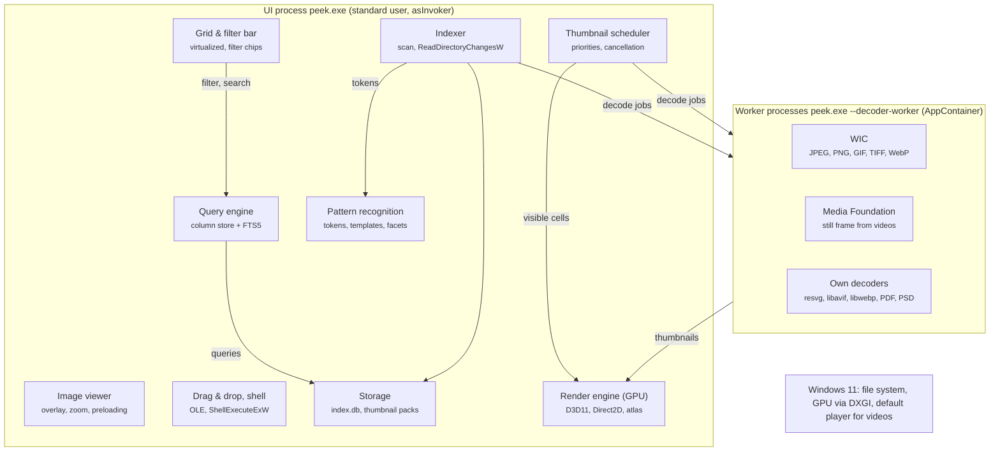

# peek – Technical concept

> Status: 19 Nov 2026, version 1.6.5. Translated from the German original. Since 1.6 the interface is available in German and English; UI labels are quoted in German (the source language of the texts), with the English text where helpful.

## Goals & requirements

peek is built as a single, statically linked C++20 Win32 application (`peek.exe`) that renders via Direct3D 11 / Direct2D, keeps metadata in a local SQLite database and contains no network code at all. Goal: folders with 10,000+ images scrollable in under a second, search across 1 million entries in under 50 ms.

| Requirement | Implementation in peek |
| --- | --- |
| Native app | C++20, Win32 API, Direct2D/DirectWrite, no runtime (.NET, WebView, Electron) |
| Portable, no installation | One EXE, static CRT (`/MT`), data next to the EXE or in `%LOCALAPPDATA%` |
| No admin rights | Manifest `asInvoker`, no services, no registry writes, no USN journal |
| Hardware acceleration | D3D11 device, DirectComposition swap chain, GPU texture atlas, DXVA video decoding for thumbnails |
| No network/internet features | No network libraries linked, build check of the import table. peek contains no network code of its own; mapped network drives (with a drive letter) are read by Windows like local drives |
| Minimal interface | One window: header with path bar and search, filter pills, grid, status bar; sidebar and info panel can be shown/hidden with animation; everything operable by keyboard |
| Filter by date, size, name, resolution etc. | In-memory column store, filters in milliseconds |
| Metadata capture while the app is active | Background indexer with low I/O priority, only while peek is running |
| Pattern recognition in names/metadata | Tokenizer + template detection (`IMG_####`), frequencies as filter facets |
| Fast search | SQLite FTS5 (trigram) + column filters, query syntax with operators |
| Folder navigation | Sidebar (quick access, collections, drives), path bar with drop-down subfolder lists, view including subfolders |
| Overview of all files | All file types of a folder in the grid, thumbnails only for images and videos, all other files with their file type icon; in large sizes, folders show the thumbnail of a contained file |
| Built-in image viewer | Borderless full screen without title bar, GPU zoom, preloading of neighboring images; JPEG/JPG, PNG, GIF, BMP, WebP, AVIF, TIFF, ICO, SVG, TGA, HEIC/HEIF (with the Windows codec) – no RAW |
| Videos external | No playback of its own; opens in the default media player via `ShellExecuteExW` |
| Drag & drop in and out | OLE `IDropTarget` / `SHDoDragDrop` with `CF_HDROP` |

## Technology stack

Plain Win32 with a self-drawn interface on Direct2D is recommended, because it gives the shortest startup time, the smallest portable file and full control over the render path.

| Component | Choice | Rationale |
| --- | --- | --- |
| Language | C++20 (MSVC), C++/WinRT only where needed | Direct access to COM APIs (WIC, Media Foundation, Shell), no runtime |
| Window & UI | Win32 + own UI toolkit on Direct2D/DirectWrite | Virtualized grid without XAML overhead, startup < 300 ms |
| Windows 11 look | Mica via `DwmSetWindowAttribute(DWMWA_SYSTEMBACKDROP_TYPE)`, rounded corners, Segoe UI Variable, light/dark mode | System look without the Windows App SDK; own dark popup menus with acrylic background (DWMSBT\_TRANSIENTWINDOW) and rounded corners |
| Composition | DirectComposition + DXGI flip-model swap chain | Tear-free scrolling at 60–144 Hz, low latency |
| Rendering | Direct3D 11.1 + Direct2D 1.3 (shared D3D device) | Broad driver base, shareable with Media Foundation |
| Image decoding | WIC with system codecs: JPEG/JPG, PNG, GIF, BMP, TIFF, ICO, WebP, AVIF, HEIC/HEIF (if present) | Scaled decoding, EXIF orientation; crops are saved via the WIC encoder; RAW deliberately unsupported. HEIC/HEIF (since 1.6.5): pixels only through Microsoft's "HEIF Image Extensions" and "HEVC Video Extensions" (no own HEVC decoder: patents and LGPL); size, rotation (irot/imir), capture date, camera and exposure data come from peek's own header reader (`core/heif.cpp`, unit and random tests), so the index is complete even without the codec. Without the codec the file shows its icon and the info panel says which extensions are needed |
| Extra codecs (static) | libwebp and libavif (decoder dav1d) as fallback without a system codec; stb\_image for the Photoshop composite image | No Store extension required, statically linked, permissive licenses (BSD, public domain) |
| Video thumbnail & metadata | Media Foundation `IMFSourceReader` with DXGI device manager (DXVA), system codecs only | One still frame via hardware decoder, duration/codec/resolution; no own HEVC decoder |
| Icons of other files | `IShellItemImageFactory` with SIIGBF\_ICONONLY: file type icon only, no thumbnail | No third-party thumbnail handlers: faster and safer |
| Document thumbnails | PDF/AI: Windows.Data.Pdf (WinRT, first page); AI XMP and PSD thumbnails read directly | Built into the system, no third-party thumbnail handlers, no network |
| PDF creation | Own PDF writer, fonts via DirectWrite and the Font Subsetting API (CreateFontPackage) | No third-party library, small PDFs, searchable text, preview = PDF |
| Image cloud | Direct2D: sprite batches (`ID2D1DeviceContext3::DrawSpriteBatch`) from thumbnail atlases (2048² px, cells 64 and 16 px), near cards drawn directly | Thousands of cards with few draw calls, no custom shaders, GPU-accelerated |
| SVG | resvg (Rust, statically linked via the C interface, `+crt-static`), built with `tools/build-resvg.ps1` | Most complete standalone SVG rendering (text, filters, masks, CSS); no network library in the EXE |
| TGA | Own decoder (`core/tga.cpp`): uncompressed and RLE, palette, grayscale, 15–32 bit | Windows has no TGA decoder; stb_image has a known, unfixed vulnerability in its TGA part. Small, with unit and random tests; runs in the sandbox |
| Tile texture | WIC (PNG decoder/encoder, `CopyPixels`/`WritePixels` in the native pixel format) | Pixel-exact without conversion, 8/16 bit, in strips with little memory |
| Database | SQLite 3 (static, WAL mode), FTS5 with trigram tokenizer | Single file, robust, substring search |
| In-memory index | Own column store (struct of arrays) | Filters across 1 million records via SIMD in a few ms |
| Build | CMake + vcpkg (triplet `x64-windows-static`) | Reproducible, one EXE (x64) |

**Rejected alternatives**

- **WinUI 3 / Windows App SDK (self-contained, unpackaged):** modern look, but over 100 MB of accompanying files, slower cold start, and the `ItemsRepeater` grid reaches its limits at 100,000 items.
- **WPF / .NET (including Native AOT):** WPF is not compatible with Native AOT; without AOT a runtime is required or the package becomes very large.
- **Electron / WebView2:** not native, high memory use, the WebView2 runtime is a network stack.
- **Rust with `windows-rs`:** technically equivalent and more memory-safe; a sensible option if the team knows Rust. The concept then applies unchanged.

## Architecture

peek consists of a UI process containing the interface, index, search and GPU rendering, and isolated worker processes that do nothing but decode media files.



*Implementation status: worker processes since 1.5 (see "Decoder isolation"); still individual bitmaps instead of a texture atlas (so far only the image cloud uses an atlas), in-memory search instead of FTS5.*

The thumbnail service, metadata reader and indexer send decode jobs to a small pool of workers; the pixels come back via shared memory. A crash in a worker never affects the interface.

**Threading model in the UI process**

| Thread | Task | Rule |
| --- | --- | --- |
| UI thread | Message loop, input, layout, drag & drop | Never blocks on I/O or the database |
| Render thread | Draws in step with the compositor | Reads only immutable snapshots |
| I/O thread | Reads files sequentially, fills buffers for the worker | One queue per physical drive |
| Indexer threads | Structure scan, metadata, tokenization | Background priority, can be paused |
| Watcher thread | `ReadDirectoryChangesW` per collection | Only reports, does not process |
| DB writer | Sole write access to SQLite, batched transactions | Reading connections in parallel (WAL) |

**Communication:** lock-free queues between the threads. The column store is updated copy-on-write: queries work on a snapshot, the indexer publishes new versions atomically. Every job carries a generation number; when the user changes folders, all older jobs are discarded.

## Portability & permissions

peek runs from a USB stick or any folder, writes nothing to the registry or system directories and needs no elevation.

**Distribution**

- A single file `peek.exe` for Windows 11 x64 only, an estimated 4–8 MB including SQLite and libwebp.
- Static CRT (`/MT`), no VC++ redistributables, no DLLs next to the EXE.
- Application manifest: `requestedExecutionLevel level="asInvoker"`, `supportedOS` Windows 10/11, `dpiAwareness PerMonitorV2`, `longPathAware true`, UTF-8 code page.
- Code signing with a dedicated certificate is recommended so that SmartScreen and virus scanners do not block the EXE.

**App icon and logo:** the designed "p" with a blue gradient from `assets/peek-icon.svg`, stored as `assets/peek.ico` (16–256 px, PNG entries) in the repository; it appears on the EXE in Explorer, in the title bar and taskbar and in Alt+Tab. "Über peek" (About peek) shows the logo with wordmark in a light and a dark variant (SVG as a program resource, drawn with Direct2D's SVG renderer). On the first start of a new build, peek refreshes the Windows icon cache for the EXE.

**Data storage**

1. If a file `peek.portable` is next to the EXE and the folder is writable: data in `.\peek-data\`.
2. Otherwise: `%LOCALAPPDATA%\peek\` (no roaming, since this is cache data).
3. Contents: `einstellungen.dat` (settings, encrypted), `index.db` and `thumbs.db` (SQLite, contents encrypted), `index.key` (key, bound to the Windows account via DPAPI).

**Deliberately avoided because they would require admin rights or installation**

- No Windows service, no autostart, no scheduled task: indexing runs only while the app is open.
- No reading of the NTFS USN journal (a volume handle usually requires admin rights); instead directory comparison and `ReadDirectoryChangesW`.
- No file type registration and no shell context menu. Optional: a menu item "create shortcut in Start menu" that only creates a `.lnk` in the user profile.
- No dependence on Store codec extensions for the core formats: they are decoded by Windows 11 without an extension, plus WebP (libwebp) and AVIF (libavif with dav1d) as built-in fallbacks. Exception (since 1.6.5): HEIC/HEIF is shown only if the Microsoft HEIF and HEVC extensions are installed (per user, no admin rights); peek installs nothing itself.

## Rendering & hardware acceleration

The GPU draws only what is visible, from textures already in graphics memory; the CPU decodes only at reduced size and in the background.

**Virtualized grid**

- The grid only knows the total number of entries and the cell size; per frame, the visible rows plus two buffer rows above and below are computed.
- Drawing uses a single `ID2D1SpriteBatch` call per atlas page instead of individual `DrawBitmap` calls.
- Scrolling is decoupled from loading: missing thumbnails immediately show a placeholder in the image's average color (from the database), then the thumbnail fades in.
- Kinetic scrolling and precision touchpad via `DirectManipulation`; frame timing via `DCompositionWaitForCompositorClock`.

**Rows of variable height:** file names are never truncated but wrapped. To keep this fast with 100,000 entries, peek wraps names using its own character width table (glyph metrics of the font, determined once per character) instead of a text layout per file, and stores the row tops as a prefix sum. Visible rows and hit testing are found by binary search; recomputation happens only when the view, column width or tile size changes.

**Thumbnail pipeline**

1. **Cache hit in the pack:** the thumbnail is stored as JPEG/WebP (256 px long edge, plus 512 px for HiDPI) in `thumbs\*.pak`; read via memory mapping, decoded via WIC.
2. **Embedded thumbnail:** EXIF thumbnail in the JPEG, if ≥ the desired size.
3. **Scaled decoding:** WIC `IWICBitmapSourceTransform` decodes JPEGs directly at 1/2, 1/4 or 1/8 size; `IWICPlanarBitmapSourceTransform` provides Y and CbCr planes, which Direct2D converts to RGB on the GPU via the YCbCr effect.
4. **Video:** Media Foundation `IMFSourceReader` with `MF_SOURCE_READER_D3D_MANAGER`, seek to about 10 % of the duration, one frame via the DXVA hardware decoder, output directly as a D3D11 texture. Only with the codecs present in Windows (e.g. H.264, VP9); peek ships no HEVC decoder – such videos get the file type icon.
5. **Upload:** the result goes into a free tile of a texture atlas (4096 × 4096 BGRA, 256 tiles of 256 px).

**Documents with thumbnails (exception):** PDF shows the first page (built-in WinRT feature `Windows.Data.Pdf`, page count in the info panel), Illustrator (AI) is read like PDF, otherwise the embedded XMP thumbnail; Photoshop (PSD/PSB) shows the stored composite image (`stb_image`), otherwise the embedded JPEG thumbnail. At the bottom right, the thumbnail carries the icon of the default app. **All other file types** (documents, archives, audio, unknown types, including RAW, and HEIC without the Windows codec) appear with their file type icon (`IShellItemImageFactory` with `SIIGBF_ICONONLY`, cached per extension). Third-party shell thumbnail handlers are never called.

**Folder thumbnails** (as in Windows Explorer): from a tile size of 96 px, a folder shows the folder icon with the thumbnail of a contained file on it; at smaller sizes and in the list view, only the icon.

- **Choice of file:** automatically the first image or video in the folder's current sort order; if there is none, the first from a direct subfolder (one level deep). Without a match, the empty folder icon remains. There is no manual choice.
- **Source:** the file's existing thumbnail from the cache is reused; no additional decoding is needed. The mapping is stored in `folder.cover_file_id`.
- **Non-indexed folders:** a short structure scan reads at most the first 500 entries, finds the first image/video and creates its thumbnail at low priority ("buffer" level); until then the empty icon appears.
- **Freshness:** if the cover file is deleted or moved, or the sort order changes, peek automatically picks a new one.
- **Rendering:** folder icon and thumbnail are drawn as two layers in the GPU atlas, the thumbnail fitted into the folder opening with its aspect ratio preserved; videos get a small play icon. peek writes nothing into the folder (no `desktop.ini`, no `folder.jpg`).

**Prioritization**

- Queue with three levels: visible > buffer rows > background index. When scrolling fast, outdated jobs are discarded.
- Decoder threads = number of physical cores − 1; I/O through its own read queue so HDDs are not slowed down by parallel access.

**Memory budgets**

| Cache | Contents | Default budget |
| --- | --- | --- |
| GPU atlas | Thumbnails of visible and neighboring cells (LRU) | 512 MB, adapted to `DXGI_ADAPTER_DESC.DedicatedVideoMemory` |
| RAM cache | Compressed thumbnails of the most recent folders | 256 MB |
| Disk | `thumbs\*.pak`, append-only, periodic compaction | unlimited, limit configurable |

**Robustness:** device loss (`DXGI_ERROR_DEVICE_REMOVED`) leads to rebuilding the device and atlas without data loss; for systems without a suitable GPU, WARP serves as a software fallback.

## Indexing & metadata

The indexer works only while peek is open, at background priority, and after a restart continues exactly where it left off.

**Libraries:** the user adds root folders as "Sammlungen" (collections), by drag & drop or via the menu. Only these are fully indexed; any other folder can still be browsed and is captured temporarily when opened. All file types are recorded, image and video metadata only for the supported formats. Only local drives are allowed (GetDriveTypeW: DRIVE\_FIXED, DRIVE\_REMOVABLE).

**Three passes**

1. **Structure scan:** `FindFirstFileExW` with `FindExInfoBasic` and `FIND_FIRST_EX_LARGE_FETCH` returns name, size, timestamps and attributes without opening files. Comparing with the index by (path, size, modification time) detects new, changed and deleted files. Target: 50,000–100,000 entries/s on SSD.
2. **Metadata:** read header data (WIC frame `GetSize`, EXIF/XMP via `IWICMetadataQueryReader`, video via Media Foundation or `IPropertyStore`). Only the first kilobytes of a file are read.
3. **Thumbnails:** created in advance for collections, on demand for other folders.

**Freshness at runtime:** `ReadDirectoryChangesW` (asynchronous, recursive) per collection. On buffer overflow, the affected subtree is rescanned.

**Resource friendliness**

- Lowest CPU priority (`THREAD_PRIORITY_LOWEST`), but no background I/O mode: that also throttles database writes so much that the view waits for locked tables.
- Pauses while the interface is busy (input, thumbnails and metadata for the view; resumes after about 0.7 s of idle) and while the image viewer is open.
- Short transactions (at most 400 files or 100 metadata records) so the database is never locked for long for the view. Documents (PDF, PSD, AI) get thumbnails and metadata like media; the page count is stored in the `dur` field.

**Captured metadata**

| Group | Fields |
| --- | --- |
| File | Path, name, extension, size, created, modified, attributes, file ID (`FILE_ID_INFO`) to detect renames |
| Image | Width, height, aspect ratio, megapixels, color depth, orientation, average color |
| EXIF/XMP | Capture date, camera make/model, lens, focal length, aperture, exposure, ISO, GPS coordinates, rating, keywords |
| Video | Duration, resolution, frame rate, video/audio codec, bit rate, capture date |
| Derived | Name tokens, name template, optional perceptual hash (dHash) for duplicates |

**Database schema (excerpt, SQLite)**

```sql
CREATE TABLE folder (id INTEGER PRIMARY KEY, parent_id INTEGER, path TEXT UNIQUE, scanned_at INTEGER,
  cover_file_id INTEGER);
CREATE TABLE file (
  id INTEGER PRIMARY KEY, folder_id INTEGER NOT NULL, name TEXT, ext TEXT,
  size INTEGER, ctime INTEGER, mtime INTEGER, file_id BLOB,
  kind INTEGER,            -- 1 image, 2 video, 3 other file
  width INTEGER, height INTEGER, duration_ms INTEGER,
  taken_at INTEGER, camera TEXT, lens TEXT, iso INTEGER, rating INTEGER,
  lat REAL, lon REAL, avg_color INTEGER, dhash INTEGER,
  template_id INTEGER, meta_state INTEGER, thumb_ref INTEGER
);
CREATE INDEX file_folder ON file(folder_id);
CREATE INDEX file_taken ON file(taken_at);
CREATE TABLE token (id INTEGER PRIMARY KEY, text TEXT UNIQUE, source INTEGER, df INTEGER);
CREATE TABLE file_token (file_id INTEGER, token_id INTEGER, PRIMARY KEY(token_id, file_id)) WITHOUT ROWID;
CREATE TABLE template (id INTEGER PRIMARY KEY, pattern TEXT UNIQUE, df INTEGER);
CREATE VIRTUAL TABLE file_fts USING fts5(name, path, keywords, content='', tokenize='trigram');
```

Settings: `PRAGMA journal_mode=WAL`, `synchronous=NORMAL`, `mmap_size=256MB`, `page_size=8192`. One writer thread, any number of reading connections.

## Pattern recognition

peek derives filter terms purely statistically and locally from file names, folder names and metadata – without an AI model and without the cloud; the most frequent and most distinctive terms appear as filter chips.

**1. Tokenization**

- Split at separators (`_ - . , ( ) [ ]` and spaces), at case changes (`SommerUrlaub` → `sommer`, `urlaub`) and at letter/digit boundaries (`img2041` → `img`, `2041`).
- Normalize: lowercase, Unicode NFC, merge umlaut variants (`muenchen` = `münchen`).
- Folder names in the path are carried as a separate source (source "Ordner"/folder), EXIF fields as source "Metadaten"/metadata (e.g. `Fujifilm X-T5`, `35 mm`).

**2. Detection of typical patterns**

| Pattern | Example | Result |
| --- | --- | --- |
| Date in the name | `20240817_143012.jpg`, `2024-08-17` | Date as a filter value; compared with the EXIF date |
| Camera/device prefix | `IMG_`, `DSC_`, `PXL_`, `DJI_`, `GOPR` | Facet "Quelle" (source) |
| Screenshots & messengers | `Screenshot`, `WhatsApp Image` | Facet "Quelle" (source) |
| Sequence numbers | `Urlaub (12).jpg`, `_0042` | Removed, not counted as a term |
| Edit variants | `_edit`, `-bearbeitet`, `_v2`, `(1)` | Facet "Variante" (variant), grouped with the original |
| Resolution in the name | `4k`, `1920x1080` | Compared with the actual resolution |

**3. Name templates:** digit sequences are replaced by `#`, recognized dates by `{Datum}` (`IMG_20240817_1430.jpg` → `IMG_{Datum}_####`). Identical templates form groups that can be selected as their own facet.

**4. Weighting and sorting of terms**

- The document frequency (df) per term is counted relative to the current view (folder, collection or search result).
- Shown are terms with df ≥ 3 that do not occur in more than 80 % of the view (otherwise not distinctive), excluding stop words (`img`, `jpg`, `copy`, `kopie` …) and pure numbers.
- Sorted by df descending by default, switchable to alphabetical; terms that often occur together (e.g. `italien` + `rom`) are suggested as a refinement when one of them is selected.
- Users can hide or rename terms; these rules are stored in the settings.

**5. Incremental maintenance:** tokens are written per file during indexing; df values per collection are maintained in the database and, for folder or search views, computed in memory from the column store (histogram over the token IDs of the visible matches, < 20 ms for 100,000 files).

## Search & filters

Search and filters run against an in-memory column store that is loaded from SQLite at startup; SQLite itself serves as persistent storage and for full-text search.

**Column store:** one contiguous array per field (`uint64 size[]`, `uint32 width[]`, `int64 taken_at[]` …). About 80–120 MB for 1 million files. Filters are SIMD loops (AVX2, fallback SSE4.2) that produce a bit mask; multiple filters = bitwise AND. Sorting via precomputed permutations for name, date and size.

**Filters in the interface**

| Filter | Operation | Examples |
| --- | --- | --- |
| Date | Quick choices in the menu; "Individuell" (custom) opens the date picker (years › months › days, click or drag). Same for "Aufgenommen" (captured; only files with a capture date) | Today, last 7 days, 2024, Aug 2024 |
| Size | Levels in the menu, free via search (`Größe:>10mb`) | < 1 MB, 1–10 MB, > 100 MB |
| Name | Text field, substring, wildcards `*` `?` | `urlaub*`, `*_edit` |
| Resolution | Levels and megapixels | < HD, HD, Full HD, 4K, > 20 MP |
| Orientation | Portrait, landscape, square, panorama (> 2:1) |  |
| Type | Folder, image, video, PDF, Photoshop, Illustrator, other file; extension via search | JPG, PNG, WebP, AVIF, MP4, PDF, PSD, AI |
| Camera & lens | Facet list from EXIF | Fujifilm X-T5, 35 mm |
| Recognized terms | Chips from pattern recognition, by frequency | `rom`, `hochzeit`, Screenshot |
| More | Duration (video), rating, with/without GPS, duplicates |  |

Every facet value shows the number of matches under the currently active other filters, so empty results are avoided.

**Query syntax in the search field** (optional, free text is enough)

```text
rom urlaub                       terms, combined with AND
"hochzeit anna"                  exact phrase
Breite:>3000 Höhe:>2000          width / height
Megapixel:>=20                   megapixels
Größe:>10mb                      file size
Datum:2024-08..2024-09           time range (capture date, otherwise name/modification date)
Aufgenommen:2024                 only files with a capture date
Endung:jpg,png  Typ:Video        extension, type
Kamera:x-t5                      camera
Dauer:>60s                       video duration
-screenshot                      exclusion

Short forms still valid: w: h: mp: size: date: taken: ext: type: cam: dur:
```

**Executing a search**

1. Free-text terms → FTS5 query (trigram, so also substrings from 3 characters; shorter terms via prefix comparison in the column store) → set of file IDs.
2. Operators and filter chips → bit masks from the column store.
3. Intersection, sorting, handover to the grid; while typing, the result updates after an 80 ms pause, older queries are cancelled.

**Targets:** ≤ 50 ms for search + filters across 1 million files, ≤ 10 ms for pure filter changes.

**Saved views:** combinations of folder, search and filters can be stored as a "view" in the sidebar (e.g. "videos > 1 GB").

## UI concept

A single window with header, filter bar, grid and status bar; the sidebar on the left and the info panel on the right slide in and out with animation as needed.

**Main window**

- **Header (Mica):** sidebar on/off, back/forward/up, reload, path bar, search field on the right. Typing anywhere focuses the search; clicking into the search field shows the search parameters below it as blue pills (Breite, Höhe, Größe, Datum, Aufgenommen, Dauer, Endung, Kamera – width, height, size, date, captured, duration, extension, camera) and the last 10 searches (deletable individually or all at once). Double-click selects the whole search text.
- **Filter bar:** one row of pills (type including PDF/Photoshop/Illustrator, date, captured, size, resolution, orientation, source, pattern, subfolders) and recognized terms. Date and captured additionally offer "Individuell" (custom): a date picker in the style of the menus (years › months › days, click or drag for a range, with match counts). "Unterordner" (subfolders) is switched off when changing folders.
- **Sort:** always at the far right of the filter bar: name, date, size, resolution, type, captured, direction, and at the very bottom "Gruppieren" (group) – the view then gets group headers matching the sort criterion (initial letter, today/yesterday/month, size classes, resolution classes, file type; folders always as their own group).
- **Sidebar on the left (`F9`, animated):** quick access with the **Merkliste** (bookmarks; add items via the context menu with a star or by dragging; own bar with "create contact sheet …" and "clear bookmarks"; when leaving, peek returns to the exact position), collections (sortable by dragging), drives. At the bottom left, the "Einstellungen" (settings) button.
- **Thumbnail view (default):** tiles without border lines. Images, videos, PDF (first page), Photoshop and Illustrator with thumbnails – documents with the icon of their default app at the bottom right, shown as a large file icon until the thumbnail is ready –, all others with their file type icon; folders from 96 px with the thumbnail of a contained file; videos with a duration badge; bookmarked items with a white star at the top left. Names are wrapped in full.
- **Details view:** sortable list with the columns name, date, type, size, resolution. Clicking a column header sorts, column widths can be dragged at the edge (never narrower than the header and the longest content; double-click: default width). Values are single-line and only clipped at the window edge.
- **Image cloud (since 1.3):** third view between tiles and list, all items as a spatial pile (details below).
- **Selection:** click, `Ctrl`/`Shift`-click or a selection rectangle on empty space (adding with `Ctrl`, auto-scrolling at the edge).
- **Middle mouse button:** automatic scrolling as in a browser – hold and drag, or click briefly and scroll until the next click.
- **Info panel on the right (animated):** via the i icon at the bottom right or `Ctrl+I`; shows preview, type, size, resolution, duration, page count (PDF), capture/modification date, camera, lens, aperture, exposure and ISO (read on demand from the file header in the sandbox, not stored in the index; since 1.6.2), source, name pattern and folder of the selection; for multiple selections a summary.
- **Status bar (without border lines):** number of items; for the selection resolution, type and size; on the right status and index progress, then in fixed order zoom (minus – slider – plus, only in tile view), tile/list view and at the far right the i icon. Icons are white in dark mode and almost black in light mode.
- **Animations (since 1.6.6):** drop-down menus, path lists, the "…" menu, the date picker and submenus (e.g. "Öffnen mit" in the context menu) slide in vertically (120 ms) and out (90 ms) from the edge they open at; context menus themselves appear and disappear without animation. The bar at the top of the image viewer slides in and out (80 ms) immediately on a click (a double-click for zooming takes the toggle back), the search history list under the search field slides as well (120 ms).
- **Menus:** all drop-downs, path lists and context menus as separate popup windows with acrylic background and rounded corners, match counts or keyboard shortcuts on the right, app icons on the left (e.g. "Öffnen mit"/open with) and real **submenus** (open on hover, clearly visible arrow); keyboard operable, long lists scroll. Context menu with open with, Explorer, copy, copy path, paste, recycle bin, bookmarks, collection, contact sheet and (for folders) tile texture. Double-clicking a button acts like two clicks.

**Folder navigation**

- **Path bar (not an input field):** clicking a segment opens the folder; the arrow after a segment drops down its subfolders as a list.
- Double-click or `Enter` opens a folder; `Alt+↑` goes up one level; `Backspace`/`Alt+←` back; the mouse forward/back buttons move through the history.
- The "Unterordner" (subfolders) switch (`Ctrl+R`) shows all files of the subtree flat.
- Folders that are not indexed yet are shown immediately via a structure scan; metadata fills in in the background.

**Built-in image viewer**

- Opens in borderless full screen without title bar (`Enter`, `Space` or double-click); `Esc` returns to the exact grid position and restores the window.
- Transparent bar at the top with name, position, resolution, size and zoom; on the right the crop icon, info button and at the far right the X to close. A single click on the image shows and hides the bar. Right-click opens a context menu (default app, open with, Explorer, copy, copy path, original size/fit, bookmarks, recycle bin).
- **Opened from Explorer** ("Open with peek", file association; since 1.6.6): peek starts directly in the viewer. The bar at the top always starts visible (regardless of the remembered setting; a click on the image hides and shows it as usual, without changing the remembered setting); in the top left corner a large back arrow (like the X on the right) leads to the folder view of that image, `Esc` does the same. The X on the right closes peek. If peek is closed this way, the next normal start opens the previously used folder again.
- The info panel is also available in the viewer (button or `I`) and shows the data of the current image; it is linked to the panel of the overview.
- Double-click toggles between fit and 100 %. Zoom with the mouse wheel, smoothly animated around a fixed point (no arc movement), `0` fit, `1` = 100 %, `R` rotates the display. Small images are shown at original size or fitted to the view, depending on the setting. `Del` moves the image to the recycle bin (brief notice at the top; the viewer stays open and shows the next or last image).
- Navigation arrows at the far left and right edges, visible only after mouse movement and hidden again after 2 seconds; also arrow keys and the mouse forward/back buttons.
- **Crop:** via the icon in the bar (image fitted slightly smaller) or directly by dragging with the middle mouse button; handles at corners and edges, rule-of-thirds lines, pixel size, bar with "Abbrechen" (cancel) and "Speichern" (save) (Enter/Esc). JPEG, PNG, BMP and TIFF are overwritten (original to the recycle bin, JPEG at 95 % with metadata), WebP, AVIF, HEIC, GIF and ICO saved as a PNG copy.
- First the thumbnail from the cache, then the full image; neighboring images (±2) are decoded in advance.
- **Smoothing:** in the context menu "Beim Vergrößern glätten" (smooth when enlarging): on = cubic interpolation when enlarging, off (default) = sharp pixels from 3× size. Also applies in compare.
- **SVG:** base image at 2048–4096 px; when the view is at rest and the base image is coarser than the screen, resvg renders the visible section in the background at screen resolution (sharp at every zoom level). Crop is hidden for SVG.
- Future stages: tiling of very large images (over 16,384 px), animated GIF/WebP, color management via ICC profiles, HDR on HDR displays. If another app changes the folder, the viewer stays open.

**Videos and documents external:** peek never plays videos itself. Double-click/`Enter` on a video, a PDF, Photoshop or Illustrator file or any other non-image file calls `ShellExecuteExW` with the verb `open` – this starts the default app configured in Windows. "Öffnen mit" (open with) lets you choose the other registered apps (`SHAssocEnumHandlers`, "choose another app" via `SHOpenWithDialog`).

**Drag & drop**

- **In (since 1.6.6):** dropping never opens anything in peek – opening is done via "Open with peek" in the Explorer context menu. Files or folders dropped onto the empty space of the file view are copied or moved into the folder shown (from any app and from another peek window; same rules as onto folders, the target is highlighted in the path bar; not in the bookmarks or collections view, and not within the same window). Folders dropped onto the empty space of the sidebar are added as collections; onto "Merkliste" → add to bookmarks.
- **Onto folders:** dragging files or folders onto a folder in the view, a folder/drive/collection in the sidebar or a segment of the path bar copies or moves them there (same drive: move, otherwise copy; `Ctrl` = copy, `Shift` = move; the target is highlighted) – also from within peek and between peek windows. Executed via `IFileOperation` with progress dialog and undo; the view is then updated without jumping.
- **Out:** `SHDoDragDrop` with the shell items of the selection; targets such as Explorer, mail programs or image editors receive real file paths.
- Additionally: `Ctrl+C` copies files to the clipboard, `Ctrl+Shift+C` the path, `Ctrl+V` pastes files from the clipboard into the current folder (cut files are moved).

**File operations (deliberately minimal):** new folder (context menu of the empty space, `Ctrl+Shift+N`, then rename directly; since 1.6.2), delete to the recycle bin (`Del`, `IFileOperation`), "show in Explorer" (`Ctrl+E`), copy/move/paste, crop in the image viewer, contact sheet as PDF, tile texture from a PNG sequence, rename (`F2`) and the Explorer properties dialog (`Alt+Enter`).

**Languages (since 1.6):** the interface is available in German and English. By default peek follows the Windows display language (`GetUserDefaultUILanguage`: German → German, otherwise English); "Sprache" (language) in the settings switches it without a restart, `--lang=de|en` sets it for a single start. The German texts in the code are also the keys of the translation (`core/lang.h`: `T()`, `TF()` with placeholders `{0}` so word order can differ, `TC()` for context-dependent texts); the English texts are in `core/lang_en.cpp`, compiled into the EXE (no extra files, stays portable). Dates, numbers, month names and sizes follow the language (`17.08.2024` / `17 Aug 2024`, `1.234` / `1,234`, `1,5 MB` / `1.5 MB`). Search parameters are always accepted in both languages (`Breite:` and `width:` …), the suggestions below the search field appear in the chosen language. File type names come from the Windows shell and follow the Windows language. The CI step `tools/check-lang.py` checks that every marked text has a translation, that placeholders match and that no unmarked German text is left in the interface code.

**Keyboard:** full operation without a mouse; all shortcuts are listed on their own settings page ("Tastenkombinationen"/keyboard shortcuts). The mouse back button closes settings, contact sheet and tile texture. `Ctrl+1`/`Ctrl+2`/`Ctrl+3` switch between tiles, list and image cloud. A command palette (`Ctrl+K`) is planned for a later version.

**Settings page (scrollable):** "Darstellung" (appearance) with language, color mode, "Bildbetrachter im Vollbild" (image viewer in full screen; off: frameless over the work area, the taskbar stays visible; since 1.6.2) (system, light, dark) and "Kleine Bilder im Betrachter" (small images in the viewer: original size or fit to view); "Tastenkombinationen" (keyboard shortcuts) as its own page; index with data folder and location, number of indexed files and thumbnails, disk usage, collections and index status (actions: open data folder, re-index, delete index); "Über peek" (about) with logo and wordmark (light and dark variant as SVG), version and build. The Windows text scaling (Accessibility › Text size) enlarges the whole interface.

**Contact sheet (PDF, since 1.1):** right-click on one or more images or a folder → "Kontaktabzug erstellen …" (create contact sheet), likewise from the bookmarks (selected or all items) and for the current folder via the context menu of the empty space. Only image files are included; for folders the contained images (subfolders only if "Unterordner" is active).

- **Own page in the window** (like the settings), WYSIWYG: at the top a toolbar with count ("18 of 20 images · 2 pages"), "cancel" and "create PDF …"; below it an options row (A4 portrait/landscape, columns and rows 1–8 each, file names on/off, file extensions on/off, quality small/medium/high); in the middle always exactly one page with paging (arrows, Page↑/↓, mouse wheel); at the bottom a horizontal strip with all images.
- **Edit directly on the page:** type the heading with a click (applies to all pages, prefilled with "folder name DD.MM.YYYY" or "Kontaktabzug DD.MM.YYYY", the date is normal text); untick images via checkboxes (the rest move up); reorder images by dragging, also onto other pages when hovering over a paging arrow.
- **Image strip:** all images in PDF order; unticked images faded with an empty checkbox. Dragging within the strip reorders; dragging from the strip onto the page inserts there and ticks the image; clicking an image pages to its page.
- **Page layout (A4):** 12 mm margin, heading centered at the top (Segoe UI Bold 14 pt), "page x of y" centered at the bottom (Segoe UI Regular 9 pt), grid with 4 mm spacing, images fitted (EXIF orientation, transparency white; with file names aligned to the bottom so the name sits directly below the image), file names below (Segoe UI Regular 8 pt, shortened in the middle). Text always black, no lines. The page calculation lives in the platform-independent core (`core/sheetlayout`, with tests).
- **Quality:** small 150 dpi / JPEG 80 %, **medium 220 dpi / 85 % (default)**, high 300 dpi / 92 %, relative to the printed image size.
- **PDF creation:** own PDF writer without a third-party library (`pdfsheet.cpp`); images as JPEG (DCTDecode), Segoe UI Regular and Bold embedded as subsets (Type0/CIDFontType2, Identity-H, ToUnicode; Windows Font Subsetting API `CreateFontPackage`), searchable text; embedding permission is checked, otherwise Arial. Preview and PDF use the same page calculation and the same glyphs and character widths (DirectWrite glyph runs). A manually started workflow "pdftest" produces sample PDFs for review.
- **Saving:** Windows save dialog, suggesting "<heading>.pdf" in the images' folder (invalid characters replaced by "-"). Created in the background with progress and cancel; afterwards the page closes and the PDF opens in the default app. Options are saved.

**Tile texture (PNG, since 1.2):** right-click on exactly one folder → "Kacheltextur erstellen …" (create tile texture), or on empty space → "tile texture from this folder …". All PNG files directly in the folder (without subfolders) are assembled into a single PNG file in which every tile matches its source image exactly. Intended for various uses (sprite sheets, flipbooks, shaders, archiving).

- **Order:** strictly by file name, naturally sorted as in Explorer (`StrCmpLogicalW`: `f2` before `f10`); row by row from the top left.
- **Own page in the window** like the contact sheet: toolbar with folder name, count, "cancel" and "create PNG …"; options row with columns and rows (−/+, arrow keys) and the final texture size ("texture size: 1,280 × 1,280 px · 24 images of 256 × 256 · RGBA 8 bit · 1 empty cell"); below it a preview of the whole texture from the thumbnails (checkerboard for transparency, pixel art stays sharp when enlarged). On hover: number, file name, column/row and pixel position of the tile.
- **Layout:** the default is the column count that makes the texture most square (on a tie fewer empty cells, then wider); columns can be changed freely, the rows follow; "rows +/−" jumps to the next possible layout. Calculation in the platform-independent core (`core/atlaslayout`, with tests).
- **Check in advance (headers only):** all images must have the same size and the same pixel format, otherwise a message names the deviating file and nothing is created. Over 16,384 px edge length only a notice (limit of many graphics APIs and programs).
- **Pixel fidelity (`atlaswriter.cpp`):** WIC decodes each image in its own pixel format (RGB/RGBA 8 and 16 bit, grayscale 8 and 16 bit); rows are copied via `CopyPixels` directly to their place in the strip buffer and written with `WritePixels` – no scaling, no color conversion, no premultiplied alpha (the GPU display is not used for this). Palette images are taken over as RGBA 8 bit (palettes can differ per image), grayscale below 8 bit as 8 bit – the color values stay the same. Resolution and ICC color profile of the first image are taken over. Empty cells stay 0 (transparent or black).
- **Memory and saving:** in strips (at most about 64 MB buffer), only the source images of the current tile row are open. Suggests "<folder name>.png" in the parent folder (not inside the sequence); written to a temporary file, then renamed; in the background with progress and cancel. Afterwards the page closes.
- **Test:** the manually started workflow "atlastest" generates sequences in all formats (including semi-transparent pixels, palettes with transparency, 4-bit grayscale, natural sorting, differing sizes and formats) and compares each tile value by value with its source image.

**Image cloud (since 1.3):** third view (icon at the bottom right between tile and list view, `Ctrl+3`). peek remembers sidebar and info panel per view (thumbnails, list, image cloud; since 1.5.2), initially hidden in the cloud. The image viewer likewise remembers whether the top bar and the side info panel were shown.

- **Layout:** all items of the current view (filtered, searched) as cards, flat and parallel to the screen. Position in the plane random but fixed per file (hash of the path), in an ellipse matching the aspect ratio of the area; radius ∝ √n. Depth follows the sort order: the first item is at the front/top. Card area constant, aspect ratio from the thumbnail. Folders and files without a thumbnail as cards with a file icon, folders also with their name. Corners subtly rounded (at most 5 DIP like the buttons), no shadows.
- **Camera and perspective:** true central projection (45° field of view). Dragging pans, the mouse wheel moves toward the mouse position and evenly through the pile to the back; all movements smoothly damped (exponential smoothing at the display refresh rate). `Home` shows everything again. The frontmost card in the center of the view brakes the camera (you bump into it filling the screen).
- **Avoidance:** as a perspective spread – near the camera, cards move outward in proportion to their lateral distance from the camera ray (from about 5.5 card sizes of distance, increasing smoothly up to threefold). In the center of the view nothing moves; at the edge, cards glide unobtrusively aside; no special cases, no delay, never transparent.
- **Depth:** darkening (dark theme) or lightening (light theme) relative to the distance from the camera and the depth of the pile – near cards bright, even in the middle of the pile; small and large clouds graded the same way.
- **Names:** cards without a thumbnail (folders, other files, images whose thumbnail cannot be created) show the name with extension below the icon, at most two lines. The text layout is created once at a reference size and drawn scaled (no measuring per image).
- **Selection:** a click moves the camera in front of the image, cards in front of it glide out of view, everything else is dimmed; white frame and a docked info box (name without extension, type, size, resolution, date) that slides out at the bottom. A second click or `Enter` opens; clicking elsewhere, `Esc`, dragging or the mouse wheel cancel the selection. `←`/`→` jump from item to item. Up close, the image is loaded at full resolution and released again as soon as it gets smaller.
- **Keyboard and spacing (since 1.6.5):** arrow keys move the camera (with an image selected, ← / → step to the previous / next image, ↑ / ↓ deselect and move). `Ctrl+mouse wheel` changes the spacing of all cards (positions and depth are stretched, the cards keep their size; the camera stretches along), `Ctrl+0` restores the default spacing; switching to the cloud always starts with the default spacing. File names appear only on near cards (from 90 px card height, faded in up to 125 px).
- **Large clouds (since 1.6.5):** only moving cards are animated; once the cloud rests, a grid over x/y with cards sorted by depth limits drawing, evading and the search for the card in the center to what can be in view. Off-screen cards are checked for the atlas in portions (3,000 per frame), freshly arrived thumbnails first. File names wrap in fixed width steps (25 % apart, with hysteresis), new layouts get a time budget of about 1.5 ms per frame, and distant cards release them again.
- **Groups (since 1.6.3):** with "Gruppieren" switched on (sort menu), the cloud is split into vertical strips side by side, at most 6. Starting point are the groups of the other views: more than 6 are merged with their neighbors so that the strips hold roughly equal counts (names e.g. "A–C", dates e.g. "January – March 2025" or "2019 – 2021"); with fewer than 6, large groups are split further by the sort value and titled as a range (names only by their first character, e.g. digits "0–3", "4–9", so titles never get longer than "A–C"; periods "3. – 9. März 2025", sizes, megapixels; not by file type). Special groups (folders, no date, empty …) keep a strip of their own; small views get fewer strips (at least 4 items each). Strip width follows the count but is always wide enough for the title to stay readable in the overview; the strips are separated by a clear gap and fine vertical lines. Title and count sit in a bar at the top, styled like the group headers of the other views; they only move horizontally with the camera. Clicking a title moves the camera onto that strip.
- **Rearranging:** when filters, search or sort order change, every card gets a new target and moves there; if the count changes, the camera moves back to show the whole pile; filtered-out cards sink to the back and fade out, new ones fly in from the back.
- **Drawing (`cloud.cpp`):** thumbnails are rendered into atlas textures (2048² px; cells of 64 px and 16 px for distant cards, corners rounded transparently within the cell). Cards are drawn back to front as Direct2D sprite batches; placeholders and darkening are sprites from a white cell with a color. peek draws near cards (from about 150 px) directly from the thumbnail or the full resolution. The atlas is re-sorted by rank as needed so that neighboring cards lie in the same texture (few draw calls).

**Compare images (since 1.4):** with exactly two images selected, the context menu offers "Bilder vergleichen …" (compare images). Own full-screen view in the style of the viewer (`compare.cpp`), without info panel and without crop.

- **Top bar:** name, resolution, size and type per image; on the right the mode toggle (`Tab`/`M`) and the close cross. Own context menu for the image under the mouse pointer (open with, Explorer, copy, mode, fit, smoothing, bookmarks, recycle bin, properties).
- **Side by side:** each image fitted into one half; mouse wheel zoom (the point under the mouse pointer stays fixed) and panning apply to both at once.
- **Overlaid:** both images congruent in the same area; image 1 to the left of the divider, image 2 to the right. The divider follows the mouse pointer; zooming and panning (with the mouse button held) remain possible.
- Both images are fitted into the same area (zoom 1 = fitted), so different resolutions (original and reduced copy) also line up. `0` or double-click fits again, `Esc` or the mouse back button closes.

**Rename and properties (since 1.4):**

- **Rename** (`F2`, context menu; in tiles, list and image cloud, not in the viewer): input field directly over the name. Because the app draws via DirectComposition, it is a small separate window with a Windows edit control (accent border, small rounding). The name without extension is selected; `Enter` or clicking elsewhere applies, `Esc` cancels. Checked are invalid characters, reserved names (`CON`, `NUL` …) and existing names; changing only the case is possible. The item stays selected, bookmark entries are renamed along with it.
- **Properties** (`Alt+Enter`, context menu; everywhere including viewer and compare): the Explorer dialog via `SHObjectProperties`, for multiple selections `SHMultiFileProperties`.

## Security & offline guarantee

Freedom from networking is not just promised but technically checked in every build; decoders for untrusted files run isolated.

**No network – verifiable**

- No code for updates, telemetry, crash reports, online maps or license checks.
- Build gate in CI: the EXE's import table (`dumpbin /imports`) must not contain `ws2_32`, `wininet`, `winhttp`, `urlmon`, `dnsapi`, `iphlpapi`, `webservices` or `WebView2Loader`; otherwise the build fails.
- Dependencies are built with options free of network features (e.g. SQLite without extension loading).
- **SVG:** before parsing, peek checks all `href` references: only `data:` and internal references (`#id`) remain; references to other files, internet addresses, UNC and network paths are removed. DTD entities containing markup or references are rejected so that no reference can hide in them. Compressed `.svgz` files are not supported (references could not be checked in advance).
- **License notices:** `THIRD-PARTY.txt` is generated in every build from the copyright files of the vcpkg packages and the licenses of all linked Rust crates (identical texts only once) and is included in the release.
- peek contains no network code of its own. Mapped network drives (`DRIVE_REMOTE` with a drive letter, since 1.6.1) are read by Windows like local drives; paths without a drive letter (`\\server\…`) are not supported. Cloud placeholders (e.g. OneDrive "online only", attribute FILE\_ATTRIBUTE\_RECALL\_ON\_DATA\_ACCESS) are shown only with name and icon; peek reads them for no thumbnail, metadata or index, so browsing triggers no download. Only when the user explicitly opens such an image (double-click, viewer, "Open with peek", since 1.6.1) is it read – the sync client (OneDrive, Google Drive) then downloads that one file; neighboring images are only preloaded if they are already on the PC.
- GPS coordinates are used only as numbers and filters, never passed to a map service.

**Hardening**

Image and video files are untrusted – merely viewing a folder decodes them (thumbnails, index). Since 1.5 the decoders run isolated (next section); in addition, the following applies in both processes:

- **Compiler and linker:** Control Flow Guard (`/guard:cf`), shadow stacks (`/CETCOMPAT`), ASLR (`/DYNAMICBASE`, `/HIGHENTROPYVA`), DEP (`/NXCOMPAT`); termination on heap corruption (`HeapEnableTerminationOnCorruption`).
- **DLL loading:** only from System32 (`SetDefaultDllDirectories`, for static imports `/DEPENDENTLOADFLAG:0x800`). A DLL placed next to the portable `peek.exe` (e.g. in the downloads folder) is not loaded.
- **Errors in codecs:** only cases after which the process can safely continue are caught (C++ exceptions such as out of memory, null pointers, read errors on removed drives). Other access violations indicate corrupted memory; peek then terminates instead of allowing an attacker unlimited attempts.
- **Size limits:** at most 16,384 × 16,384 pixels at full resolution; WebP thumbnails are scaled down directly in the decoder, AVIF limits the image size already when reading the header.
- **Own parsers** (PSD thumbnail, SVG pre-check) check all length fields against the file size; SQL statements are fixed or parameterized.

**Decoder isolation (since 1.5)**

Everything that reads the content of untrusted files runs in helper processes `peek.exe --decoder-worker` (`sandbox.cpp`): thumbnails, images in the viewer and compare, sharp SVG sections, video still frames, PDF, Photoshop and Illustrator previews, metadata (EXIF, dimensions, duration, page count) and the images for the contact sheet.

- **AppContainer without capabilities:** no network, no access to the user's files and registry. The worker can only read the file whose handle the main process hands over; system libraries, codecs and system fonts are readable. peek creates the profile ("peek.dekoder") with the first worker and deletes it on exit; so that the container may start `peek.exe`, peek adds a read/execute permission for exactly this container to the EXE if needed (not necessary on FAT/exFAT).
- **Job object:** at most 3 GB of memory per worker, processes end with peek, no clipboard, no desktop and system settings. In addition: no child processes, strict handle checks, no extension points (AppInit DLLs), no DLLs from network drives or with a low label, heap termination, ASLR.
- **Flow:** the main process opens the file, duplicates the read handle into the worker and sends the job over a named pipe with a random name (single client only, no remote access). The pixels come back via shared memory; the main process checks the worker's size information before accepting anything. The decoders read exclusively via the handle (`fileinput.cpp`: own position, reads at fixed offsets, free-threaded for WinRT and Media Foundation).
- **Errors:** time limits per job (15–60 s). If a worker crashes or hangs, peek terminates it; the file gets no thumbnail, the next job starts a new worker. The interface stays responsive.
- **Pool:** 3–9 workers (one more than thumbnail threads), one prewarmed at startup; jobs for the same file preferably go to the same worker (SVG cache while zooming), otherwise to one that already has the matching decoder loaded (Media Foundation, PDF, resvg). Measured in CI: 0.5–1.5 ms more per image than in-process; one-time per worker 0.3–0.5 s for the first video or PDF and about 1.8 s for the system fonts on the first SVG with text (fonts are loaded only for that); about 40 MB of memory, of which 12 MB is private per worker.
- **Fallbacks:** if no AppContainer can be started, the worker runs at low integrity level (cannot change anything, but can read); if that fails too, peek decodes in its own process. The active mode is shown under "Über peek" (about).
- **Deliberately in the main process:** crop and tile texture (triggered by the user, they write files), shell file icons and peek's own thumbnails from the cache.
- **Consequences for SVG:** embedded external images are not shown, text uses only system fonts (not fonts installed only for the user).
- **CI check:** `peek.exe --sandbox-test` decodes test files (JPEG, PNG, GIF, BMP, TIFF, SVG, PDF, MP4, WMV, broken and crafted files) isolated and in-process, compares the results, requires AppContainer mode, checks that the worker cannot open a file by its path, and that the profile is removed afterwards. The fallbacks are checked the same way with `PEEK_SANDBOX=low` and `off` (honored only in test mode).
- Still planned: Spectre mitigation (`/Qspectre`) and fuzzing of the decoder paths (libFuzzer).

**Keeping libraries up to date**

peek deliberately has no update function (no network). A vulnerability in a library is therefore only fixed once a new release has been built and downloaded.

- **Fixed versions:** the C/C++ libraries come from a fixed vcpkg state (`builtin-baseline` in `vcpkg.json`), resvg with a fixed version and `Cargo.lock`. Builds are therefore reproducible; updating means deliberately raising that state.
- **Weekly check:** the workflow "sicherheit" (`tools/security-check.py`) compares all versions with the NVD (CVE database) and OSV/RustSec every Monday, reports new CVEs for stb_image (highlighting PSD relevance) and shows newer vcpkg versions. The report appears in the run summary; on a known vulnerability the run fails (GitHub notifies the owner by email), and an issue is created only if issues are enabled. Reviewed, non-applicable reports are listed with reasons in `tools/security-ignore.txt`.
- **Supply chain:** GitHub Actions are pinned by commit hash, Dependabot proposes updates. Every release contains a SHA-256 checksum; code signing is planned.
- **stb_image** barely responds to security reports; known vulnerabilities affect GIF, TGA and HDR, and peek only includes the PSD part (`STBI_ONLY_PSD`). A PSD vulnerability would require replacing it with an own, reviewed reader.

**Privacy:** the index and thumbnails contain image content in reduced form. Therefore, since 1.5.1:

- **Encrypted:** paths, file names, camera models and thumbnails are stored only in encrypted form in `index.db` and `thumbs.db` (`cachecrypt.cpp`). The key (`index.key`) is bound to the Windows user account with the Windows Data Protection API (DPAPI): on another PC, under another account or after a password reset it cannot be read, and peek starts with an empty index (it is only a cache). Paths are encrypted deterministically per folder and name (synthetic IV from HMAC-SHA256, AES-256-CTR) so that queries for "everything below a folder" keep working; only the nesting and the approximate name length remain visible. Thumbnails: random IV, AES-256-CTR, HMAC-SHA256. Numbers (size, times, dimensions, capture date) remain readable. Old, unencrypted files are deleted on first start. Measured: 20,000 entries load in about 60 ms, 2,000 thumbnails read in about 15 ms, a little over 400 bytes per entry.
- **Cleanup:** when peek deletes, moves or renames a file or folder, its entries and thumbnails disappear immediately. When a folder is read, entries of files that no longer exist there are removed (including those deleted outside peek); the indexer also cleans up the thumbnails in collections.
- **Overwriting:** `PRAGMA secure_delete` overwrites deleted data in the database, and on exit the WAL file is truncated. On SSDs the firmware may still keep old blocks for a while; only the encryption helps against that.
- "Index löschen" (delete index) removes everything; in portable mode no traces remain on the host except possibly the system thumbnail cache, which peek does not use. The settings, including collections, bookmarks and search history, are also stored encrypted in `einstellungen.dat` (same key); an old `peek.ini` is migrated once and deleted. Consequence: on another PC or after a password reset, peek starts with default settings. In portable mode each PC creates its own key; when switching between PCs, index and settings therefore start fresh on each.

**File safety:** peek opens media files read-only (`FILE_SHARE_READ | FILE_SHARE_WRITE | FILE_SHARE_DELETE`), writes no metadata into files and deletes only to the recycle bin.

## Performance targets, tests & project plan

The targets below are acceptance criteria for a reference PC (8 cores, NVMe SSD, integrated GPU) and are to be measured automatically; they are planned values, not measurements.

**Performance budgets**

| Scenario | Target |
| --- | --- |
| Cold start to usable window | ≤ 300 ms |
| Folder with 10,000 files, thumbnails cached, first image visible | ≤ 150 ms |
| Scrolling in the grid | Monitor refresh rate, no frames > 16 ms |
| Thumbnail generation JPEG 24 MP (scaled decoding) | ≥ 300 images/s |
| Open image in viewer (thumbnail → full image) | ≤ 30 ms / ≤ 150 ms |
| Search + filters across 1 million files | ≤ 50 ms |
| Memory with 1 million indexed files | ≤ 600 MB including GPU staging |

**Test strategy**

- Unit tests for tokenizer, template detection, query parser and column filters (GoogleTest).
- Test corpus of 1,000 odd files (broken JPEGs, huge PNGs, 0-byte files, Unicode/long paths > 260 characters, locked files).
- Synthetic large collection (1 million files) for load tests; measurement via ETW traces (`WPR`/`WPA`) in CI.
- Fuzzing of the decoder paths; runs as a standard user without admin, on x64, with and without the WebP system codec; rejection of UNC paths and handling of cloud placeholders.
- Test of the offline gate (import table) and of a run with the network adapter disabled.

**Project plan (milestones)**

1. **M1 – Foundation:** window, Mica, D3D11/D2D/DirectComposition, virtualized grid, WIC thumbnails without cache, folder navigation.
2. **M2 – Index:** SQLite schema, structure scan, metadata extraction, thumbnail packs, `ReadDirectoryChangesW`.
3. **M3 – Finding:** column store, filter bar, FTS5 search, query syntax.
4. **M4 – Viewing & exchange:** image viewer with preloading, videos external, drag & drop, clipboard.
5. **M5 – Patterns:** tokenizer, templates, term facets, saved views.
6. **M6 – Hardening:** worker process, hardening, fuzzing, performance polish, signing, release.

**Rendering and frame pacing (since 1.6.4):** the swap chain is waitable: before drawing, peek waits for the display's frame signal instead of blocking in `Present`, and animation steps are aligned to the refresh period of the monitor the window is on (even motion although CPU time varies). Finished thumbnails are uploaded to the GPU with a time budget per frame (4 ms while animating). Row geometry caches groups and natural name widths, so sliding the sidebar or info panel no longer re-measures every file name per frame. The image viewer repaints only when its display changes and keeps the filtered image of a resting view at screen resolution (bit-identical, checked by `--render-check` in the build). Near cards in the image cloud are filled with a bitmap brush and rounded corners instead of one layer per card (identical image area; only the 1 px anti-aliased edge differs slightly). `Ctrl+Shift+F12` toggles a small frame-time display (undocumented diagnostic).

**Implementation status:** version 1.6.5 is published as a release in the repository [tn-023/peek](https://github.com/tn-023/peek); builds run on GitHub Actions (tests and offline check on every push, releases via the "release" workflow). Added since 0.3: bookmarks, search history and German search parameters, grouping, the "captured" filter and sort, date picker, submenus with "open with", paste and drop onto folders, crop and context menu in the viewer, AVIF, thumbnails for PDF/PSD/AI, color mode, text scaling, keyboard shortcuts page, smoother animations, new icon and logo, contact sheet as PDF (1.1), the pixel-exact tile texture from PNG sequences (1.2), the image cloud (1.3), plus SVG, compare images, rename and the properties dialog (1.4), hardening including the weekly library check (1.4.1), decoders in the sandbox (1.5), the encrypted index and settings (1.5.1) and the English interface (1.6). Still missing from M6: FTS5 full-text search, the texture atlas for the tile view (the image cloud already uses its own thumbnail atlas) and tiling of very large images. For distribution without a SmartScreen warning, code signing (Azure Artifact Signing for organizations or an OV certificate) is planned; even then, reputation builds up only over a few weeks.

**Risks and mitigations**

| Risk | Impact | Mitigation |
| --- | --- | --- |
| SmartScreen/virus scanners block an unsigned EXE | Start fails for the user | Code signing, no packed/obfuscated binaries |
| Virus scanners slow down mass reads | Slower indexing | Sequential reading, headers instead of whole files, throttling |
| Weak or buggy GPU drivers | Rendering errors | Device-loss handling, WARP fallback, driver blocklist |
| Very large collections (> 5 million files) | RAM use of the column store | Columns loadable per collection, 32-bit IDs, compressed strings |
| Removable drives with changing drive letters | Orphaned index | Identify collections by volume GUID instead of drive letter |

**Open decisions**

- None at present – image formats, video playback and thumbnails are decided.
