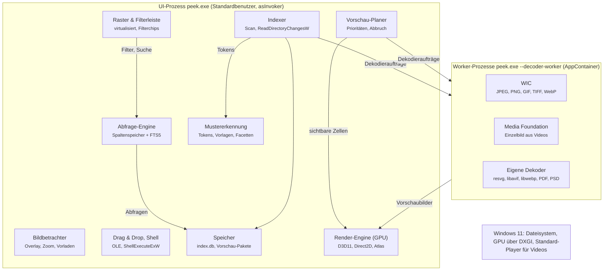

# peek – Technisches Konzept

> Kopie des technischen Konzepts (Stand: 18.11.2026, Version 1.5.1). Das Original wird als [Claude-Dokument](https://claude.ai/artifact/1yq4LLUV6psmV3DNE3JuHS) gepflegt.

## Zielbild & Anforderungen

peek wird als einzelne, statisch gelinkte C++20-Win32-Anwendung (`peek.exe`) gebaut, die über Direct3D 11 / Direct2D rendert, Metadaten in einer lokalen SQLite-Datenbank hält und keinerlei Netzwerkcode enthält. Ziel: Ordner mit 10.000+ Bildern in unter einer Sekunde durchscrollbar, Suche über 1 Mio. Einträge in unter 50 ms.

| Anforderung | Umsetzung in peek |
| --- | --- |
| Native App | C++20, Win32-API, Direct2D/DirectWrite, keine Laufzeit (.NET, WebView, Electron) |
| Portabel, keine Installation | Eine EXE, statische CRT (`/MT`), Daten neben der EXE oder in `%LOCALAPPDATA%` |
| Keine Admin-Rechte | Manifest `asInvoker`, keine Dienste, keine Registry-Schreibzugriffe, kein USN-Journal |
| Hardwarebeschleunigung | D3D11-Gerät, DirectComposition-Swapchain, GPU-Texturatlas, DXVA-Videodekodierung für Vorschaubilder |
| Keine Netzwerk-/Internetfunktionen | Keine Netzwerkbibliotheken gelinkt, Build-Prüfung der Import-Tabelle; nur lokale Datenträger – Netzlaufwerke und UNC-Pfade sind ohne Option ausgeschlossen |
| Minimalistisches Interface | Ein Fenster: Kopfzeile mit Pfadleiste und Suche, Filterpillen, Raster, Statusleiste; Seitenleiste und Info-Panel animiert ein-/ausblendbar; alles per Tastatur bedienbar |
| Filter nach Datum, Größe, Name, Auflösung u. a. | In-Memory-Spaltenspeicher, Filter in Millisekunden |
| Metadatenerfassung bei aktiver App | Hintergrund-Indexer mit niedriger I/O-Priorität, nur solange peek läuft |
| Mustererkennung in Namen/Metadaten | Tokenizer + Vorlagen-Erkennung (`IMG_####`), Häufigkeiten als Filter-Facetten |
| Schnelle Suche | SQLite FTS5 (Trigram) + Spaltenfilter, Abfragesyntax mit Operatoren |
| Ordnernavigation | Seitenleiste (Schnellzugriff, Sammlungen, Laufwerke), Pfadleiste mit aufklappbaren Unterordner-Listen, Ansicht inkl. Unterordner |
| Übersicht aller Dateien | Alle Dateitypen eines Ordners im Raster, Vorschaubilder nur für Bilder und Videos, alle übrigen Dateien mit Dateitypsymbol; Ordner zeigen in großer Darstellung das Vorschaubild einer enthaltenen Datei |
| Integrierter Bildbetrachter | Randloses Vollbild ohne Titelleiste, GPU-Zoom, Vorladen der Nachbarbilder; JPEG/JPG, PNG, GIF, BMP, WebP, AVIF, TIFF, ICO, SVG, TGA – kein RAW, kein HEIC |
| Videos extern | Keine eigene Wiedergabe; Öffnen im Standard-Mediaplayer via `ShellExecuteExW` |
| Drag & Drop rein und raus | OLE `IDropTarget` / `SHDoDragDrop` mit `CF_HDROP` |

## Technologie-Stack

Empfohlen ist reines Win32 mit selbst gezeichneter Oberfläche auf Direct2D, weil das die kürzeste Startzeit, die kleinste portable Datei und volle Kontrolle über den Renderpfad liefert.

| Baustein | Wahl | Begründung |
| --- | --- | --- |
| Sprache | C++20 (MSVC), C++/WinRT nur punktuell | Direkter Zugriff auf COM-APIs (WIC, Media Foundation, Shell), keine Laufzeit |
| Fenster & UI | Win32 + eigenes UI-Toolkit auf Direct2D/DirectWrite | Virtualisiertes Raster ohne XAML-Overhead, Start < 300 ms |
| Windows-11-Optik | Mica über `DwmSetWindowAttribute(DWMWA_SYSTEMBACKDROP_TYPE)`, runde Ecken, Segoe UI Variable, Hell/Dunkel-Modus | System-Look ohne Windows App SDK; eigene dunkle Popup-Menüs mit Acrylic-Hintergrund (DWMSBT\_TRANSIENTWINDOW) und runden Ecken |
| Komposition | DirectComposition + DXGI-Flip-Model-Swapchain | Tearing-freies Scrollen mit 60–144 Hz, geringe Latenz |
| Rendering | Direct3D 11.1 + Direct2D 1.3 (gemeinsames D3D-Gerät) | Breite Treiberbasis, gemeinsam nutzbar mit Media Foundation |
| Bilddekodierung | WIC mit Systemcodecs: JPEG/JPG, PNG, GIF, BMP, TIFF, ICO, WebP, AVIF (falls vorhanden) | Skalierte Dekodierung, EXIF-Ausrichtung; Zuschnitt wird per WIC-Encoder gespeichert; RAW und HEIC/HEIF bewusst nicht unterstützt |
| Zusatzcodec (statisch) | libwebp und libavif (Decoder dav1d) als Rückfallebene ohne Systemcodec; stb\_image für das Photoshop-Gesamtbild | Keine Store-Erweiterung vorausgesetzt, statisch gelinkt, freie Lizenzen (BSD, gemeinfrei) |
| Video-Vorschau & Metadaten | Media Foundation `IMFSourceReader` mit DXGI-Gerätemanager (DXVA), nur Systemcodecs | Ein Standbild per Hardwaredekoder, Dauer/Codec/Auflösung; kein eigener HEVC-Dekoder |
| Symbole sonstiger Dateien | `IShellItemImageFactory` mit SIIGBF\_ICONONLY: nur Dateitypsymbol, kein Vorschaubild | Keine fremden Thumbnail-Handler: schneller und sicherer |
| Dokument-Vorschauen | PDF/AI: Windows.Data.Pdf (WinRT, erste Seite); AI-XMP- und PSD-Vorschaubild selbst gelesen | Im System enthalten, keine fremden Thumbnail-Handler, kein Netzwerk |
| PDF-Erzeugung | Eigener PDF-Schreiber, Schriften per DirectWrite und Font Subsetting API (CreateFontPackage) | Keine Fremdbibliothek, kleine PDFs, durchsuchbarer Text, Vorschau = PDF |
| Bilderwolke | Direct2D: Sprite-Batches (`ID2D1DeviceContext3::DrawSpriteBatch`) aus Vorschaubild-Atlanten (2048² px, Zellen 64 und 16 px), nahe Karten direkt | Tausende Karten mit wenigen Zeichenaufrufen, keine eigenen Shader, GPU-beschleunigt |
| SVG | resvg (Rust, statisch gelinkt über die C-Schnittstelle, `+crt-static`), gebaut mit `tools/build-resvg.ps1` | Vollständigste eigenständige SVG-Darstellung (Text, Filter, Masken, CSS); keine Netzwerkbibliothek in der EXE |
| TGA | eigener Dekoder (`core/tga.cpp`): unkomprimiert und RLE, Palette, Graustufen, 15–32 Bit | Windows hat keinen TGA-Dekoder; stb_image hat im TGA-Teil eine bekannte, nicht behobene Lücke. Klein, mit Unit- und Zufallstests; läuft in der Sandbox |
| Kacheltextur | WIC (PNG-Decoder/-Encoder, `CopyPixels`/`WritePixels` im nativen Pixelformat) | Pixelgenau ohne Umrechnung, 8/16 Bit, streifenweise mit wenig Arbeitsspeicher |
| Datenbank | SQLite 3 (statisch, WAL-Modus), FTS5 mit Trigram-Tokenizer | Einzeldatei, robust, Teilstring-Suche |
| Arbeitsspeicher-Index | Eigener Spaltenspeicher (Struct-of-Arrays) | Filter über 1 Mio. Datensätze per SIMD in wenigen ms |
| Build | CMake + vcpkg (Triplet `x64-windows-static`) | Reproduzierbar, eine EXE (x64) |

**Verworfene Alternativen**

- **WinUI 3 / Windows App SDK (self-contained, unpackaged):** moderner Look, aber über 100 MB Begleitdateien, langsamerer Kaltstart und das `ItemsRepeater`-Raster kommt bei 100.000 Elementen an Grenzen.
- **WPF / .NET (auch Native AOT):** WPF ist mit Native AOT nicht kompatibel; ohne AOT ist eine Laufzeit nötig oder das Paket wird sehr groß.
- **Electron / WebView2:** nicht nativ, hoher Speicherbedarf, WebView2-Runtime ist ein Netzwerk-Stack.
- **Rust mit `windows-rs`:** technisch gleichwertig und speichersicherer; sinnvolle Option, falls das Team Rust beherrscht. Das Konzept gilt dann unverändert.

## Architektur

peek besteht aus einem UI-Prozess, der Oberfläche, Index, Suche und GPU-Rendering enthält, und einem abgeschotteten Worker-Prozess, der ausschließlich Mediendateien dekodiert.



*Umsetzungsstand: Worker-Prozesse ab 1.5 (siehe „Abschottung der Dekoder“); noch einzelne Bitmaps statt Texturatlas (einen Atlas nutzt bisher nur die Bilderwolke), Suche im Arbeitsspeicher statt FTS5.*

Vorschau-Dienst, Metadaten-Leser und Indexer schicken Dekodieraufträge an einen kleinen Pool von Workern; die Pixel kommen über gemeinsamen Speicher zurück. Ein Absturz im Worker betrifft nie die Oberfläche.

**Threading-Modell im UI-Prozess**

| Thread | Aufgabe | Regel |
| --- | --- | --- |
| UI-Thread | Nachrichtenschleife, Eingabe, Layout, Drag & Drop | Blockiert nie auf I/O oder Datenbank |
| Render-Thread | Zeichnet im Takt des Compositors | Liest nur unveränderliche Snapshots |
| I/O-Thread | Liest Dateien sequenziell, füllt Puffer für den Worker | Eine Warteschlange je physischem Datenträger |
| Indexer-Threads | Struktur-Scan, Metadaten, Tokenisierung | Hintergrundpriorität, pausierbar |
| Watcher-Thread | `ReadDirectoryChangesW` je Sammlung | Meldet nur, verarbeitet nicht |
| DB-Schreiber | Einziger Schreibzugriff auf SQLite, Bündel-Transaktionen | Lesende Verbindungen parallel (WAL) |

**Kommunikation:** Sperrfreie Warteschlangen zwischen den Threads. Der Spaltenspeicher wird nach dem Copy-on-Write-Prinzip aktualisiert: Abfragen arbeiten auf einem Snapshot, der Indexer veröffentlicht neue Versionen atomar. Jeder Auftrag trägt eine Generationsnummer; wechselt der Nutzer den Ordner, werden alle älteren Aufträge verworfen.

## Portabilität & Rechte

peek läuft vom USB-Stick oder aus einem beliebigen Ordner, schreibt nichts in Registry oder Systemverzeichnisse und benötigt keine Erhöhung.

**Auslieferung**

- Eine Datei `peek.exe` nur für Windows 11 x64, geschätzt 4–8 MB inkl. SQLite und libwebp.
- Statische CRT (`/MT`), keine VC++-Redistributables, keine DLLs neben der EXE.
- Anwendungsmanifest: `requestedExecutionLevel level="asInvoker"`, `supportedOS` Windows 10/11, `dpiAwareness PerMonitorV2`, `longPathAware true`, UTF-8-Codepage.
- Code-Signatur mit eigenem Zertifikat empfohlen, damit SmartScreen und Virenscanner die EXE nicht blockieren.

**App-Symbol und Logo:** das gestaltete „p“ mit blauem Verlauf aus `assets/peek-icon.svg`, als `assets/peek.ico` (16–256 px, PNG-Einträge) im Repository; es erscheint an der EXE im Explorer, in Titel- und Taskleiste und bei Alt+Tab. „Über peek“ zeigt das Logo mit Schriftzug in einer hellen und einer dunklen Variante (SVG als Programmressource, gezeichnet mit dem SVG-Renderer von Direct2D). Beim ersten Start eines neuen Builds frischt peek den Symbol-Cache von Windows für die EXE auf.

**Datenablage**

1. Liegt neben der EXE eine Datei `peek.portable` und ist der Ordner beschreibbar: Daten in `.\peek-data\`.
2. Sonst: `%LOCALAPPDATA%\peek\` (kein Roaming, da Cache-Daten).
3. Inhalt: `einstellungen.dat` (Einstellungen, verschlüsselt), `index.db` und `thumbs.db` (SQLite, Inhalte verschlüsselt), `index.key` (Schlüssel, per DPAPI an das Windows-Konto gebunden).

**Bewusst vermieden, weil Admin-Rechte oder Installation nötig wären**

- Kein Windows-Dienst, kein Autostart, kein geplanter Task: Indexierung läuft nur bei geöffneter App.
- Kein Lesen des NTFS-USN-Journals (Volume-Handle erfordert in der Regel Admin-Rechte); stattdessen Verzeichnisvergleich und `ReadDirectoryChangesW`.
- Keine Dateityp-Registrierung und kein Shell-Kontextmenü. Optional: Menüpunkt „Verknüpfung im Startmenü anlegen“, der nur eine `.lnk` im Benutzerprofil erzeugt.
- Keine Store-Codec-Erweiterungen voraussetzen; unterstützt werden nur Bildformate, die Windows 11 ohne Erweiterung dekodiert, dazu WebP (libwebp) und AVIF (libavif mit dav1d) als eingebaute Rückfallebene.

## Rendering & Hardwarebeschleunigung

Die GPU zeichnet nur, was sichtbar ist, aus Texturen, die bereits im Grafikspeicher liegen; die CPU dekodiert ausschließlich verkleinert und im Hintergrund.

**Virtualisiertes Raster**

- Das Raster kennt nur die Gesamtzahl der Einträge und die Zellgröße; pro Frame werden die sichtbaren Zeilen plus je zwei Puffer-Zeilen oben und unten berechnet.
- Gezeichnet wird mit einem einzigen `ID2D1SpriteBatch`-Aufruf pro Atlasseite statt einzelner `DrawBitmap`-Aufrufe.
- Scrollen ist entkoppelt vom Laden: fehlende Vorschauen zeigen sofort einen Platzhalter mit der Durchschnittsfarbe des Bildes (aus der Datenbank), dann blendet das Vorschaubild ein.
- Kinetisches Scrollen und Präzisions-Touchpad über `DirectManipulation`; Frame-Takt über `DCompositionWaitForCompositorClock`.

**Zeilen variabler Höhe:** Dateinamen werden nie abgeschnitten, sondern umbrochen. Damit das bei 100.000 Einträgen schnell bleibt, bricht peek die Namen mit einer eigenen Zeichenbreiten-Tabelle (Glyphenmetriken der Schrift, einmal je Zeichen ermittelt) statt mit einem Text-Layout je Datei um und speichert die Zeilenoberkanten als Präfixsumme. Sichtbare Zeilen und Trefferprüfung finden sich per Binärsuche; neu berechnet wird nur bei geänderter Ansicht, Spaltenbreite oder Kachelgröße.

**Vorschaubild-Pipeline (Thumbnail)**

1. **Cache-Treffer im Paket:** Vorschau liegt als JPEG/WebP (256 px lange Kante, zusätzlich 512 px für HiDPI) in `thumbs\*.pak`; Lesen per Memory-Mapping, Dekodierung per WIC.
2. **Eingebettete Vorschau:** EXIF-Thumbnail im JPEG, falls ≥ gewünschte Größe.
3. **Skalierte Dekodierung:** WIC `IWICBitmapSourceTransform` dekodiert JPEGs direkt in 1/2, 1/4 oder 1/8 Größe; `IWICPlanarBitmapSourceTransform` liefert Y- und CbCr-Ebenen, die Direct2D per YCbCr-Effekt auf der GPU in RGB wandelt.
4. **Video:** Media Foundation `IMFSourceReader` mit `MF_SOURCE_READER_D3D_MANAGER`, Sprung auf ca. 10 % der Laufzeit, ein Frame per DXVA-Hardwaredekoder, Ausgabe direkt als D3D11-Textur. Nur mit den in Windows vorhandenen Codecs (z. B. H.264, VP9); peek liefert keinen HEVC-Dekoder mit – solche Videos erhalten das Dateitypsymbol.
5. **Upload:** Ergebnis wandert in eine freie Kachel eines Texturatlas (4096 × 4096 BGRA, 256 Kacheln à 256 px).

**Dokumente mit Vorschaubild (Ausnahme):** PDF zeigt die erste Seite (eingebaute WinRT-Funktion `Windows.Data.Pdf`, Seitenzahl im Info-Panel), Illustrator (AI) wird wie PDF gelesen, sonst das eingebettete XMP-Vorschaubild, Photoshop (PSD/PSB) das mitgespeicherte Gesamtbild (`stb_image`), sonst das eingebettete JPEG-Vorschaubild. Unten rechts trägt das Vorschaubild das Symbol der Standard-App. **Alle übrigen Dateitypen** (Dokumente, Archive, Audio, unbekannte Typen, auch RAW oder HEIC) erscheinen mit dem Dateitypsymbol (`IShellItemImageFactory` mit `SIIGBF_ICONONLY`, je Endung zwischengespeichert). Fremde Shell-Thumbnail-Handler werden nie aufgerufen.

**Ordner-Vorschaubilder** (wie im Windows Explorer): Ab einer Kachelgröße von 96 px zeigt ein Ordner das Ordnersymbol mit dem Vorschaubild einer enthaltenen Datei darauf; in kleineren Größen und in der Listenansicht nur das Symbol.

- **Auswahl der Datei:** automatisch das erste Bild bzw. Video in der aktuellen Sortierung des Ordners; enthält er keines, das erste aus einem direkten Unterordner (eine Ebene tief). Ohne Treffer bleibt das leere Ordnersymbol. Eine manuelle Auswahl gibt es nicht.
- **Herkunft:** Es wird das bereits vorhandene Vorschaubild der Datei aus dem Cache wiederverwendet, es entsteht kein zusätzlicher Dekodieraufwand. Die Zuordnung steht in `folder.cover_file_id`.
- **Nicht indexierte Ordner:** Ein kurzer Struktur-Scan liest höchstens die ersten 500 Einträge, sucht das erste Bild/Video und erzeugt dessen Vorschau mit niedriger Priorität (Stufe „Puffer“); bis dahin erscheint das leere Symbol.
- **Aktualität:** Wird die Titeldatei gelöscht oder verschoben oder ändert sich die Sortierung, wählt peek automatisch eine neue.
- **Darstellung:** Ordnersymbol und Vorschaubild werden als zwei Ebenen im GPU-Atlas gezeichnet, das Vorschaubild seitenverhältnistreu in die Öffnung des Ordners eingepasst; Videos erhalten ein kleines Play-Symbol. peek schreibt dabei nichts in den Ordner (keine `desktop.ini`, kein `folder.jpg`).

**Priorisierung**

- Warteschlange mit drei Stufen: sichtbar > Puffer-Zeilen > Hintergrundindex. Beim schnellen Scrollen werden veraltete Aufträge verworfen.
- Dekoder-Threads = Anzahl physischer Kerne − 1; I/O über eine eigene Lese-Warteschlange, damit HDDs nicht durch parallele Zugriffe ausgebremst werden.

**Speicherbudgets**

| Cache | Inhalt | Standardbudget |
| --- | --- | --- |
| GPU-Atlas | Vorschauen sichtbarer und benachbarter Zellen (LRU) | 512 MB, angepasst an `DXGI_ADAPTER_DESC.DedicatedVideoMemory` |
| RAM-Cache | Komprimierte Vorschauen der letzten Ordner | 256 MB |
| Platte | `thumbs\*.pak`, Append-only, periodische Verdichtung | unbegrenzt, Limit einstellbar |

**Robustheit:** Geräteverlust (`DXGI_ERROR_DEVICE_REMOVED`) führt zu einem Neuaufbau von Gerät und Atlas ohne Datenverlust; für Systeme ohne taugliche GPU greift WARP als Software-Fallback.

## Indexierung & Metadaten

Der Indexer arbeitet nur, solange peek geöffnet ist, mit Hintergrundpriorität, und setzt nach einem Neustart genau dort fort, wo er aufgehört hat.

**Bibliotheken:** Der Nutzer legt Stammordner als „Sammlungen“ an (per Drag & Drop oder Menü). Nur diese werden vollständig indexiert; beliebige andere Ordner sind trotzdem browsebar und werden beim Öffnen flüchtig erfasst. Erfasst werden alle Dateitypen, Bild- und Videometadaten nur für die unterstützten Formate. Zulässig sind nur lokale Datenträger (GetDriveTypeW: DRIVE\_FIXED, DRIVE\_REMOVABLE).

**Ablauf in drei Pässen**

1. **Struktur-Scan:** `FindFirstFileExW` mit `FindExInfoBasic` und `FIND_FIRST_EX_LARGE_FETCH` liefert Name, Größe, Zeitstempel und Attribute ohne Dateien zu öffnen. Vergleich mit dem Index über (Pfad, Größe, Änderungszeit) erkennt neue, geänderte und gelöschte Dateien. Ziel: 50.000–100.000 Einträge/s auf SSD.
2. **Metadaten:** Kopfdaten lesen (WIC-Frame `GetSize`, EXIF/XMP über `IWICMetadataQueryReader`, Video über Media Foundation bzw. `IPropertyStore`). Es werden nur die ersten Kilobytes einer Datei gelesen.
3. **Vorschaubilder:** werden für Sammlungen vorab erzeugt, für sonstige Ordner nur bei Bedarf.

**Aktualität während der Laufzeit:** `ReadDirectoryChangesW` (asynchron, rekursiv) je Sammlung. Bei Pufferüberlauf wird der betroffene Teilbaum neu gescannt.

**Ressourcenschonung**

- Niedrigste CPU-Priorität (`THREAD_PRIORITY_LOWEST`), aber kein Hintergrund-E/A-Modus: dieser drosselt auch die Datenbank-Schreibzugriffe so stark, dass die Ansicht auf gesperrte Tabellen wartet.
- Pause, solange die Oberfläche arbeitet (Eingaben, Vorschaubilder und Metadaten der Ansicht; weiter nach etwa 0,7 s Ruhe) und während der Bildbetrachter offen ist.
- Kurze Transaktionen (höchstens 400 Dateien bzw. 100 Metadaten-Sätze), damit die Datenbank für die Ansicht nie lange gesperrt ist. Dokumente (PDF, PSD, AI) erhalten Vorschaubilder und Metadaten wie Medien; die Seitenzahl steht im Feld dur.

**Erfasste Metadaten**

| Gruppe | Felder |
| --- | --- |
| Datei | Pfad, Name, Endung, Größe, erstellt, geändert, Attribute, Datei-ID (`FILE_ID_INFO`) zur Erkennung von Umbenennungen |
| Bild | Breite, Höhe, Seitenverhältnis, Megapixel, Farbtiefe, Ausrichtung, Durchschnittsfarbe |
| EXIF/XMP | Aufnahmedatum, Kamera-Hersteller/-Modell, Objektiv, Brennweite, Blende, Belichtung, ISO, GPS-Koordinaten, Bewertung, Schlagwörter |
| Video | Dauer, Auflösung, Bildrate, Video-/Audio-Codec, Bitrate, Aufnahmedatum |
| Abgeleitet | Namens-Tokens, Namensvorlage, optional Wahrnehmungs-Hash (dHash) für Duplikate |

**Datenbankschema (Auszug, SQLite)**

```sql
CREATE TABLE folder (id INTEGER PRIMARY KEY, parent_id INTEGER, path TEXT UNIQUE, scanned_at INTEGER,
  cover_file_id INTEGER);
CREATE TABLE file (
  id INTEGER PRIMARY KEY, folder_id INTEGER NOT NULL, name TEXT, ext TEXT,
  size INTEGER, ctime INTEGER, mtime INTEGER, file_id BLOB,
  kind INTEGER,            -- 1 Bild, 2 Video, 3 sonstige Datei
  width INTEGER, height INTEGER, duration_ms INTEGER,
  taken_at INTEGER, camera TEXT, lens TEXT, iso INTEGER, rating INTEGER,
  lat REAL, lon REAL, avg_color INTEGER, dhash INTEGER,
  template_id INTEGER, meta_state INTEGER, thumb_ref INTEGER
);
CREATE INDEX file_folder ON file(folder_id);
CREATE INDEX file_taken ON file(taken_at);
CREATE TABLE token (id INTEGER PRIMARY KEY, text TEXT UNIQUE, source INTEGER, df INTEGER);
CREATE TABLE file_token (file_id INTEGER, token_id INTEGER, PRIMARY KEY(token_id, file_id)) WITHOUT ROWID;
CREATE TABLE template (id INTEGER PRIMARY KEY, pattern TEXT UNIQUE, df INTEGER);
CREATE VIRTUAL TABLE file_fts USING fts5(name, path, keywords, content='', tokenize='trigram');
```

Einstellungen: `PRAGMA journal_mode=WAL`, `synchronous=NORMAL`, `mmap_size=256MB`, `page_size=8192`. Ein Schreib-Thread, beliebig viele Lese-Verbindungen.

## Mustererkennung

peek leitet Filterbegriffe rein statistisch und lokal aus Dateinamen, Ordnernamen und Metadaten ab – ohne KI-Modell und ohne Cloud; die häufigsten und trennschärfsten Begriffe erscheinen als Filterchips.

**1. Tokenisierung**

- Zerlegen an Trennzeichen (`_ - . , ( ) [ ]` und Leerzeichen), an Groß/Klein-Wechseln (`SommerUrlaub` → `sommer`, `urlaub`) und an Buchstabe/Ziffer-Grenzen (`img2041` → `img`, `2041`).
- Normalisieren: Kleinschreibung, Unicode-NFC, Umlaut-Varianten zusammenführen (`muenchen` = `münchen`).
- Ordnernamen des Pfads werden als eigene Quelle mitgeführt (Quelle „Ordner“), EXIF-Felder als Quelle „Metadaten“ (z. B. `Fujifilm X-T5`, `35 mm`).

**2. Erkennung typischer Muster**

| Muster | Beispiel | Ergebnis |
| --- | --- | --- |
| Datum im Namen | `20240817_143012.jpg`, `2024-08-17` | Datum als Filterwert; Abgleich mit EXIF-Datum |
| Kamera-/Gerätepräfix | `IMG_`, `DSC_`, `PXL_`, `DJI_`, `GOPR` | Facette „Quelle“ |
| Bildschirmfotos & Messenger | `Screenshot`, `WhatsApp Image` | Facette „Quelle“ |
| Laufnummern | `Urlaub (12).jpg`, `_0042` | Werden entfernt, nicht als Begriff gezählt |
| Bearbeitungsvarianten | `_edit`, `-bearbeitet`, `_v2`, `(1)` | Facette „Variante“, Gruppierung mit Original |
| Auflösung im Namen | `4k`, `1920x1080` | Abgleich mit tatsächlicher Auflösung |

**3. Namensvorlagen:** Ziffernfolgen werden durch `#`, erkannte Daten durch `{Datum}` ersetzt (`IMG_20240817_1430.jpg` → `IMG_{Datum}_####`). Gleiche Vorlagen bilden Gruppen, die als eigene Facette wählbar sind.

**4. Gewichtung und Sortierung der Begriffe**

- Gezählt wird die Dokumenthäufigkeit (df) je Begriff, bezogen auf die aktuelle Ansicht (Ordner, Sammlung oder Suchergebnis).
- Angezeigt werden Begriffe mit df ≥ 3, die nicht in mehr als 80 % der Ansicht vorkommen (sonst nicht trennscharf), ohne Stoppwörter (`img`, `jpg`, `copy`, `kopie` …) und ohne reine Zahlen.
- Sortierung standardmäßig nach df absteigend, umschaltbar auf alphabetisch; Begriffe, die häufig gemeinsam auftreten (z. B. `italien` + `rom`), werden bei Auswahl des einen als Verfeinerung vorgeschlagen.
- Nutzer können Begriffe ausblenden oder umbenennen; diese Regeln liegen in den Einstellungen.

**5. Inkrementelle Pflege:** Tokens werden beim Indexieren je Datei geschrieben; df-Werte pro Sammlung werden in der Datenbank gepflegt und für Ordner- oder Suchansichten aus dem Spaltenspeicher im Arbeitsspeicher berechnet (Histogramm über die Token-IDs der sichtbaren Treffer, < 20 ms für 100.000 Dateien).

## Suche & Filter

Suche und Filter laufen gegen einen Spaltenspeicher im Arbeitsspeicher, der beim Start aus SQLite geladen wird; SQLite selbst dient als dauerhafte Ablage und für die Volltextsuche.

**Spaltenspeicher:** Je Feld ein zusammenhängendes Array (`uint64 size[]`, `uint32 width[]`, `int64 taken_at[]` …). Bei 1 Mio. Dateien ca. 80–120 MB. Filter sind SIMD-Schleifen (AVX2, Rückfall SSE4.2) und liefern eine Bitmaske; mehrere Filter = bitweises UND. Sortierung über vorberechnete Permutationen für Name, Datum und Größe.

**Filter im Interface**

| Filter | Bedienung | Beispiele |
| --- | --- | --- |
| Datum | Schnellwahl im Menü; „Individuell“ öffnet den Datums-Picker (Jahre › Monate › Tage, Klick oder Ziehen). Gleiches für „Aufgenommen“ (nur Dateien mit Aufnahmedatum) | Heute, letzte 7 Tage, 2024, Aug 2024 |
| Größe | Stufen im Menü, frei über die Suche (Größe:>10mb) | < 1 MB, 1–10 MB, > 100 MB |
| Name | Textfeld, Teilstring, Platzhalter `*` `?` | `urlaub*`, `*_edit` |
| Auflösung | Stufen und Megapixel | < HD, HD, Full HD, 4K, > 20 MP |
| Ausrichtung | Hoch, quer, quadratisch, Panorama (> 2:1) |  |
| Typ | Ordner, Bild, Video, PDF, Photoshop, Illustrator, sonstige Datei; Endung über die Suche | JPG, PNG, WebP, AVIF, MP4, PDF, PSD, AI |
| Kamera & Objektiv | Facettenliste aus EXIF | Fujifilm X-T5, 35 mm |
| Erkannte Begriffe | Chips aus der Mustererkennung, nach Häufigkeit | `rom`, `hochzeit`, Screenshot |
| Weitere | Dauer (Video), Bewertung, mit/ohne GPS, Duplikate |  |

Jeder Facettenwert zeigt die Trefferzahl unter den aktuell aktiven übrigen Filtern, damit Leerergebnisse vermieden werden.

**Abfragesyntax im Suchfeld** (optional, Freitext genügt)

```text
rom urlaub                       Begriffe, UND-verknüpft
"hochzeit anna"                  exakte Phrase
Breite:>3000 Höhe:>2000          Breite / Höhe
Megapixel:>=20                   Megapixel
Größe:>10mb                      Dateigröße
Datum:2024-08..2024-09           Zeitraum (Aufnahme-, sonst Namens-/Änderungsdatum)
Aufgenommen:2024                 nur Dateien mit Aufnahmedatum
Endung:jpg,png  Typ:Video        Endung, Typ
Kamera:x-t5                      Kamera
Dauer:>60s                       Videodauer
-screenshot                      Ausschluss

Kurzformen weiterhin gültig: w: h: mp: size: date: taken: ext: type: cam: dur:
```

**Ausführung einer Suche**

1. Freitextbegriffe → FTS5-Abfrage (Trigram, also auch Teilstrings ab 3 Zeichen; kürzere Begriffe über Präfixvergleich im Spaltenspeicher) → Menge von Datei-IDs.
2. Operatoren und Filterchips → Bitmasken aus dem Spaltenspeicher.
3. Schnittmenge, Sortierung, Übergabe an das Raster; Ergebnis wird beim Tippen nach 80 ms Pause aktualisiert, alte Abfragen werden abgebrochen.

**Zielwerte:** ≤ 50 ms für Suche + Filter über 1 Mio. Dateien, ≤ 10 ms für reine Filteränderungen.

**Gespeicherte Ansichten:** Kombinationen aus Ordner, Suche und Filtern lassen sich als „Ansicht“ in der Seitenleiste ablegen (z. B. „Videos > 1 GB“).

## UI-Konzept

Ein einziges Fenster mit Kopfzeile, Filterleiste, Raster und Statusleiste; Seitenleiste links und Info-Panel rechts fahren bei Bedarf animiert ein und aus.

**Hauptfenster**

- **Kopfzeile (Mica):** Seitenleiste ein/aus, Zurück/Vor/Hoch, Neu laden, Pfadleiste, Suchfeld rechts. Tippen an beliebiger Stelle fokussiert die Suche; ein Klick ins Suchfeld zeigt darunter die Suchparameter als blaue Pillen (Breite, Höhe, Größe, Datum, Aufgenommen, Dauer, Endung, Kamera) und die letzten 10 Suchen (einzeln oder alle löschbar). Doppelklick markiert den ganzen Suchtext.
- **Filterleiste:** eine Zeile Pillen (Typ inkl. PDF/Photoshop/Illustrator, Datum, Aufgenommen, Größe, Auflösung, Ausrichtung, Quelle, Muster, Unterordner) und erkannte Begriffe. Datum und Aufgenommen haben zusätzlich „Individuell“: ein Datums-Picker im Stil der Menüs (Jahre › Monate › Tage, Klick oder Ziehen für einen Zeitraum, mit Trefferzahlen). „Unterordner“ wird beim Wechsel des Ordners ausgeschaltet.
- **Sortieren:** immer ganz rechts in der Filterleiste: Name, Datum, Größe, Auflösung, Typ, Aufgenommen, Richtung und ganz unten „Gruppieren“ – die Ansicht erhält dann Gruppenköpfe passend zum Sortierkriterium (Anfangsbuchstabe, Heute/Gestern/Monat, Größenklassen, Auflösungsklassen, Dateityp; Ordner immer als eigene Gruppe).
- **Seitenleiste links (`F9`, animiert):** Schnellzugriff mit der **Merkliste** (Elemente per Kontextmenü mit Stern oder durch Ziehen hinzufügen; eigene Leiste mit „Kontaktabzug erstellen …“ und „Merkliste leeren“; beim Verlassen kehrt peek an die exakte Stelle zurück), Sammlungen (per Ziehen sortierbar), Laufwerke. Unten links der Button „Einstellungen“.
- **Vorschaubild-Ansicht (Standard):** Kacheln ohne Rahmenlinien. Bilder, Videos, PDF (erste Seite), Photoshop und Illustrator mit Vorschaubild – Dokumente mit dem Symbol ihrer Standard-App unten rechts, bis zum fertigen Vorschaubild als großes Dateisymbol –, alle anderen mit Dateitypsymbol; Ordner ab 96 px mit dem Vorschaubild einer enthaltenen Datei; Videos mit Dauer-Badge; Elemente der Merkliste mit weißem Stern oben links. Namen werden vollständig umbrochen.
- **Detailansicht:** sortierbare Liste mit den Spalten Name, Datum, Typ, Größe, Auflösung. Klick auf einen Spaltenkopf sortiert, Spaltenbreiten lassen sich am Rand ziehen (nie schmaler als Überschrift und längster Inhalt; Doppelklick: Standardbreite). Werte stehen einzeilig und werden am Fensterrand nur abgeschnitten.
- **Bilderwolke (ab 1.3):** dritte Ansicht zwischen Kacheln und Liste, alle Elemente als räumlicher Haufen (Details unten).
- **Auswahl:** Klick, `Strg`/`Umschalt`-Klick oder Auswahlrechteck auf freier Fläche (mit `Strg` ergänzend, am Rand automatisch weiterscrollend).
- **Mittlere Maustaste:** automatisches Scrollen wie im Browser – halten und ziehen, oder kurz klicken und bis zum nächsten Klick scrollen.
- **Info-Panel rechts (animiert):** über das i-Symbol unten rechts oder `Strg+I`; zeigt Vorschau, Typ, Größe, Auflösung, Dauer, Seitenzahl (PDF), Aufnahme-/Änderungsdatum, Kamera, Quelle, Namensmuster und Ordner der Auswahl, bei Mehrfachauswahl eine Zusammenfassung.
- **Statusleiste (ohne Rahmenlinien):** Anzahl der Elemente, für die Auswahl Auflösung, Typ und Größe; rechts Status und Indexfortschritt, dann in fester Reihenfolge Zoom (Minus – Regler – Plus, nur in der Kachelansicht), Kachel-/Listenansicht und ganz rechts das i-Symbol. Symbole weiß im dunklen, fast schwarz im hellen Farbmodus.
- **Menüs:** alle Dropdowns, Pfadlisten und Kontextmenüs als eigene Popup-Fenster mit Acrylic-Hintergrund und abgerundeten Ecken, Trefferzahlen bzw. Tastenkürzeln rechts, App-Symbolen links (z. B. „Öffnen mit“) und echten **Untermenüs** (Aufklappen beim Darüberfahren, gut sichtbarer Pfeil); per Tastatur bedienbar, lange Listen scrollen. Kontextmenü mit Öffnen mit, Explorer, Kopieren, Pfad kopieren, Einfügen, Papierkorb, Merkliste, Sammlung, Kontaktabzug und (bei Ordnern) Kacheltextur. Doppelklick auf einen Button wirkt wie zwei Klicks.

**Navigation in Ordnern**

- **Pfadleiste (kein Eingabefeld):** Klick auf ein Segment öffnet den Ordner; der Pfeil hinter einem Segment klappt dessen Unterordner als Liste auf.
- Doppelklick oder `Enter` öffnet einen Ordner; `Alt+↑` eine Ebene höher; `Rücktaste`/`Alt+←` zurück; die Maustasten vor/zurück blättern im Verlauf.
- Schalter „Unterordner“ (`Strg+R`) zeigt alle Dateien des Teilbaums flach.
- Ordner, die noch nicht indexiert sind, werden sofort per Struktur-Scan angezeigt; Metadaten füllen sich im Hintergrund nach.

**Integrierter Bildbetrachter**

- Öffnet im randlosen Vollbild ohne Titelleiste (`Enter`, `Leertaste` oder Doppelklick); `Esc` führt zurück zur exakten Rasterposition und stellt das Fenster wieder her.
- Transparente Leiste oben mit Name, Position, Auflösung, Größe und Zoom; rechts Zuschnitt-Symbol, Info-Knopf und ganz rechts das X zum Schließen. Ein einfacher Klick auf das Bild blendet die Leiste ein und aus. Rechtsklick öffnet ein Kontextmenü (Standard-App, Öffnen mit, Explorer, Kopieren, Pfad kopieren, Originalgröße/Einpassen, Merkliste, Papierkorb).
- Das Info-Panel steht auch im Betrachter zur Verfügung (Knopf oder `I`) und zeigt die Daten des aktuellen Bildes; es ist mit dem Panel der Übersicht gekoppelt.
- Doppelklick wechselt zwischen Einpassen und 100 %. Zoom per Mausrad weich animiert um einen festen Punkt (keine Bogenbewegung), `0` einpassen, `1` = 100 %, `R` dreht die Anzeige. Kleine Bilder werden je nach Einstellung in Originalgröße oder an die Ansicht angepasst gezeigt. `Entf` legt das Bild in den Papierkorb (kurzer Hinweis oben, der Betrachter bleibt offen und zeigt das nächste bzw. letzte Bild).
- Blätter-Pfeile ganz am linken und rechten Rand, nur nach einer Mausbewegung sichtbar und nach 2 Sekunden wieder ausgeblendet; zusätzlich Pfeiltasten und die Maustasten vor/zurück.
- **Zuschneiden:** über das Symbol in der Leiste (Bild etwas kleiner eingepasst) oder direkt durch Aufziehen mit der mittleren Maustaste; Griffe an Ecken und Kanten, Drittel-Linien, Pixelgröße, Leiste mit „Abbrechen“ und „Speichern“ (Enter/Esc). JPEG, PNG, BMP und TIFF werden überschrieben (Original in den Papierkorb, JPEG mit 95 % und Metadaten), WebP, AVIF, GIF und ICO als PNG-Kopie.
- Erst die Vorschau aus dem Cache, danach das volle Bild; Nachbarbilder (±2) werden vorab dekodiert.
- **Glätten:** Im Kontextmenü „Beim Vergrößern glätten“: an = kubische Interpolation beim Vergrößern, aus (Standard) = ab dreifacher Größe scharfkantige Pixel. Gilt auch im Vergleich.
- **SVG:** Grundbild in 2048–4096 px; ruht die Ansicht und ist das Grundbild gröber als der Bildschirm, rendert resvg den sichtbaren Ausschnitt im Hintergrund in Bildschirmauflösung (scharf in jeder Zoomstufe). Zuschneiden ist bei SVG ausgeblendet.
- Ausbaustufe: Kachelung sehr großer Bilder (über 16.384 px), animierte GIF/WebP, Farbmanagement über ICC-Profile, HDR auf HDR-Displays. Ändert eine andere App den Ordner, bleibt der Betrachter offen.

**Videos und Dokumente extern:** peek spielt Videos nie selbst ab. Doppelklick/`Enter` auf ein Video, eine PDF-, Photoshop- oder Illustrator-Datei oder jede andere Nicht-Bild-Datei ruft `ShellExecuteExW` mit dem Verb `open` auf – es startet die in Windows eingestellte Standard-App. Über „Öffnen mit“ lassen sich die übrigen registrierten Apps wählen (`SHAssocEnumHandlers`, „Andere App auswählen“ über `SHOpenWithDialog`).

**Drag & Drop**

- **Hinein:** Ordner auf eine freie Fläche → öffnen; auf die Seitenleiste → als Sammlung hinzufügen; auf „Merkliste“ → zur Merkliste; Dateien → deren Ordner öffnen und Datei markieren.
- **Auf Ordner:** Dateien oder Ordner auf einen Ordner in der Ansicht, einen Ordner/ein Laufwerk/eine Sammlung in der Seitenleiste oder ein Segment der Pfadleiste ziehen kopiert bzw. verschiebt sie dorthin (gleiches Laufwerk: verschieben, sonst kopieren; `Strg` = kopieren, `Umschalt` = verschieben; das Ziel wird hervorgehoben) – auch aus peek selbst. Ausführung über `IFileOperation` mit Fortschrittsdialog und Rückgängig; die Ansicht wird danach ohne Springen aktualisiert.
- **Heraus:** `SHDoDragDrop` mit den Shell-Items der Auswahl; Ziele wie Explorer, Mail-Programm oder Bildbearbeitung erhalten echte Dateipfade.
- Ergänzend: `Strg+C` kopiert Dateien in die Zwischenablage, `Strg+Umschalt+C` den Pfad, `Strg+V` fügt Dateien aus der Zwischenablage in den aktuellen Ordner ein (ausgeschnittene werden verschoben).

**Dateioperationen (bewusst knapp):** Löschen in den Papierkorb (`Entf`, `IFileOperation`), „Im Explorer zeigen“ (`Strg+E`), Kopieren/Verschieben/Einfügen, Zuschneiden im Bildbetrachter, Kontaktabzug als PDF, Kacheltextur aus einer PNG-Sequenz, Umbenennen (`F2`) und der Eigenschaften-Dialog des Explorers (`Alt+Enter`).

**Tastatur:** vollständige Bedienung ohne Maus; alle Kürzel stehen auf einer eigenen Seite der Einstellungen („Tastenkombinationen“). Die Maustaste Zurück schließt Einstellungen, Kontaktabzug und Kacheltextur. `Strg+1`/`Strg+2`/`Strg+3` wechseln zwischen Kacheln, Liste und Bilderwolke. Eine Befehlspalette (`Strg+K`) ist für eine spätere Version vorgesehen.

**Einstellungen-Seite (scrollbar):** „Darstellung“ mit Farbmodus (System, Hell, Dunkel) und „Kleine Bilder im Betrachter“ (Originalgröße oder an die Ansicht anpassen); „Tastenkombinationen“ als eigene Seite; Index mit Datenordner und Speicherort, Anzahl der indexierten Dateien und Vorschaubilder, Speicherbedarf, Sammlungen und Indexstatus (Aktionen: Datenordner öffnen, Neu indexieren, Index löschen); „Über peek“ mit Logo samt Schriftzug (helle und dunkle Variante als SVG), Version und Build. Die Windows-Textskalierung (Bedienungshilfen › Textgröße) vergrößert die ganze Oberfläche.

**Kontaktabzug (PDF, ab 1.1):** Rechtsklick auf ein oder mehrere Bilder oder einen Ordner → „Kontaktabzug erstellen …“, ebenso aus der Merkliste (ausgewählte oder alle Elemente) und für den aktuellen Ordner über das Kontextmenü der freien Fläche. Aufgenommen werden nur Bilddateien; bei Ordnern die enthaltenen Bilder (Unterordner nur, wenn „Unterordner“ aktiv ist).

- **Eigene Seite im Fenster** (wie die Einstellungen), WYSIWYG: oben eine Werkzeugleiste mit Anzahl („18 von 20 Bildern · 2 Seiten“), „Abbrechen“ und „PDF erstellen …“; darunter eine Optionszeile (A4 Hoch-/Querformat, Spalten und Zeilen je 1–8, Dateinamen ein/aus, Dateiendungen ein/aus, Qualität Klein/Mittel/Hoch); in der Mitte immer genau eine Seite mit Blättern (Pfeile, Bild↑/↓, Mausrad); unten ein horizontaler Bildstreifen mit allen Bildern.
- **Direkt auf der Seite bearbeiten:** Überschrift per Klick eintippen (gilt für alle Seiten, vorbelegt mit „Ordnername TT.MM.JJJJ“ bzw. „Kontaktabzug TT.MM.JJJJ“, das Datum ist normaler Text); Bilder per Kästchen aushaken (die übrigen rücken nach); Bilder per Ziehen umsortieren, beim Verweilen über einem Blätterpfeil auch auf andere Seiten.
- **Bildstreifen:** alle Bilder in PDF-Reihenfolge; ausgehakte Bilder blass mit leerem Kästchen. Ziehen im Streifen sortiert um; Ziehen vom Streifen auf die Seite fügt dort ein und hakt an; Klick auf ein Bild blättert zu seiner Seite.
- **Seitenaufbau (A4):** 12 mm Rand, Überschrift oben mittig (Segoe UI Bold 14 pt), „Seite x von y“ unten mittig (Segoe UI Regular 9 pt), Raster mit 4 mm Abstand, Bilder eingepasst (EXIF-Ausrichtung, Transparenz weiß; mit Dateinamen unten bündig, damit der Name direkt unter dem Bild steht), Dateinamen darunter (Segoe UI Regular 8 pt, in der Mitte gekürzt). Text immer schwarz, keine Linien. Die Seitenberechnung liegt im plattformunabhängigen Kern (`core/sheetlayout`, mit Tests).
- **Qualität:** Klein 150 dpi / JPEG 80 %, **Mittel 220 dpi / 85 % (Standard)**, Hoch 300 dpi / 92 %, bezogen auf die gedruckte Bildgröße.
- **PDF-Erzeugung:** eigener PDF-Schreiber ohne Fremdbibliothek (`pdfsheet.cpp`); Bilder als JPEG (DCTDecode), Segoe UI Regular und Bold als Teilmenge eingebettet (Type0/CIDFontType2, Identity-H, ToUnicode; Windows Font Subsetting API `CreateFontPackage`), Text durchsuchbar; Einbettungserlaubnis wird geprüft, sonst Arial. Vorschau und PDF nutzen dieselbe Seitenberechnung und dieselben Glyphen und Zeichenbreiten (DirectWrite-Glyphenläufe). Ein von Hand gestarteter Workflow „pdftest“ erzeugt Beispiel-PDFs zur Prüfung.
- **Speichern:** Windows-Speichern-Dialog, Vorschlag „<Überschrift>.pdf“ im Ordner der Bilder (unzulässige Zeichen durch „-“ ersetzt). Erstellung im Hintergrund mit Fortschritt und Abbrechen; danach schließt sich die Seite und das PDF öffnet sich in der Standard-App. Optionen werden gespeichert.

**Kacheltextur (PNG, ab 1.2):** Rechtsklick auf genau einen Ordner → „Kacheltextur erstellen …“ (oder auf die freie Fläche → „Kacheltextur aus diesem Ordner …“). Alle PNG-Dateien direkt im Ordner (ohne Unterordner) werden zu einer einzigen PNG-Datei zusammengesetzt, in der jede Kachel exakt mit ihrem Einzelbild übereinstimmt. Gedacht für verschiedene Anwendungen (Sprite-Sheets, Flipbooks, Shader, Archiv).

- **Reihenfolge:** ausschließlich nach Dateinamen, natürlich sortiert wie im Explorer (`StrCmpLogicalW`: `f2` vor `f10`); zeilenweise von links oben.
- **Eigene Seite im Fenster** wie der Kontaktabzug: Werkzeugleiste mit Ordnername, Anzahl, „Abbrechen“ und „PNG erstellen …“; Optionszeile mit Spalten und Zeilen (−/+, Pfeiltasten) und der finalen Texturgröße („Texturgröße: 1.280 × 1.280 px · 24 Bilder à 256 × 256 · RGBA 8 Bit · 1 leeres Feld“); darunter die Vorschau der ganzen Textur aus den Vorschaubildern (Schachbrett bei Transparenz, Pixelgrafik beim Vergrößern scharf). Beim Darüberfahren: Nummer, Dateiname, Spalte/Zeile und Pixelposition der Kachel.
- **Aufteilung:** Standard ist die Spaltenzahl, bei der die Textur am quadratischsten wird (bei Gleichstand weniger leere Felder, dann breiter); Spalten frei änderbar, die Zeilen ergeben sich; „Zeilen +/−“ springt zur nächsten möglichen Aufteilung. Berechnung im plattformunabhängigen Kern (`core/atlaslayout`, mit Tests).
- **Prüfung vorab (nur Dateiköpfe):** alle Bilder gleich groß und im selben Pixelformat, sonst Meldung mit der abweichenden Datei und kein Erstellen. Über 16.384 px Kantenlänge nur ein Hinweis (Grenze vieler Grafik-APIs und Programme).
- **Pixeltreue (`atlaswriter.cpp`):** WIC dekodiert jedes Bild im eigenen Pixelformat (RGB/RGBA 8 und 16 Bit, Graustufen 8 und 16 Bit); die Zeilen werden per `CopyPixels` direkt an ihre Stelle im Streifenpuffer kopiert und mit `WritePixels` geschrieben – keine Skalierung, keine Farbumrechnung, kein vormultipliziertes Alpha (die GPU-Darstellung wird dafür nicht benutzt). Palettenbilder werden als RGBA 8 Bit übernommen (Paletten können je Bild verschieden sein), Graustufen unter 8 Bit als 8 Bit – die Farbwerte bleiben gleich. Auflösung und ICC-Farbprofil des ersten Bildes werden übernommen. Leere Felder bleiben 0 (transparent bzw. schwarz).
- **Speicher und Speichern:** streifenweise (höchstens ca. 64 MB Puffer), pro Kachelzeile sind nur deren Einzelbilder geöffnet. Vorschlag „<Ordnername>.png“ im übergeordneten Ordner (nicht in der Sequenz); Schreiben in eine temporäre Datei, dann umbenennen; im Hintergrund mit Fortschritt und Abbrechen. Danach schließt sich die Seite.
- **Test:** der von Hand gestartete Workflow „atlastest“ erzeugt Sequenzen in allen Formaten (auch halbtransparente Pixel, Paletten mit Transparenz, 4-Bit-Graustufen, natürliche Sortierung, abweichende Größen und Formate) und vergleicht jede Kachel Wert für Wert mit dem Einzelbild.

**Bilderwolke (ab 1.3):** dritte Ansicht (Symbol unten rechts zwischen Kachel- und Listenansicht, `Strg+3`). Seitenleiste und Info-Bereich merkt sich peek je Ansicht (Vorschaubilder, Liste, Bilderwolke; ab 1.5.2), in der Wolke anfangs ausgeblendet. Der Bildbetrachter merkt sich ebenso, ob die Leiste oben und der Info-Bereich an der Seite angezeigt waren.

- **Anordnung:** alle Elemente der aktuellen Ansicht (gefiltert, gesucht) als Karten, flach und parallel zum Bildschirm. Lage in der Ebene zufällig, aber je Datei fest (Hash des Pfads), in einer Ellipse passend zum Seitenverhältnis der Fläche; Radius ∝ √n. Die Tiefe folgt der Sortierung: das erste Element liegt vorn bzw. oben. Kartenfläche konstant, Seitenverhältnis aus dem Vorschaubild. Ordner und Dateien ohne Vorschau als Karten mit Dateisymbol, Ordner zusätzlich mit Namen. Ecken dezent abgerundet (höchstens 5 DIP wie die Buttons), keine Schatten.
- **Kamera und Perspektive:** echte Zentralprojektion (45° Bildwinkel). Ziehen verschiebt, das Mausrad fährt zur Mausposition hin und gleichmäßig durch den Haufen bis nach hinten; alle Bewegungen weich gedämpft (Exponential-Glättung im Takt der Bildwiederholung). `Pos1` zeigt wieder alles. Die vorderste Karte in der Bildmitte bremst die Kamera (man stößt bildschirmfüllend dagegen).
- **Ausweichen:** als perspektivische Spreizung – nahe der Kamera rücken Karten proportional zu ihrem seitlichen Abstand vom Kamerastrahl nach außen (ab etwa 5,5 Kartengrößen Abstand, weich zunehmend bis zum Dreifachen). In der Bildmitte bewegt sich dadurch nichts, am Rand gleiten Karten unauffällig zur Seite; keine Fallunterscheidungen, keine Verzögerung, nie durchsichtig.
- **Tiefe:** Abdunklung (dunkles Design) bzw. Aufhellung (helles Design) relativ zum Abstand von der Kamera und zur Tiefe des Haufens – nahe Karten hell, auch mitten im Haufen; kleine und große Wolken gleich abgestuft.
- **Namen:** Karten ohne Vorschaubild (Ordner, sonstige Dateien, Bilder ohne erzeugbares Vorschaubild) zeigen unter dem Symbol den Namen mit Endung, höchstens zwei Zeilen. Das Text-Layout entsteht einmal in einer Bezugsgröße und wird skaliert gezeichnet (kein Messen pro Bild).
- **Auswahl:** Klick fährt die Kamera vor das Bild, Karten davor gleiten aus dem Bild, alles andere wird zurückgenommen; weißer Rahmen und ein angedocktes Info-Feld (Name ohne Endung, Typ, Größe, Auflösung, Datum), das nach unten herausfährt. Zweiter Klick oder `Enter` öffnet; Klick daneben, `Esc`, Ziehen oder Mausrad heben die Auswahl auf. `←`/`→` springen von Element zu Element. Aus der Nähe wird das Bild in voller Auflösung nachgeladen und wieder freigegeben, sobald es kleiner ist.
- **Neu anordnen:** Ändern sich Filter, Suche oder Sortierung, bekommt jede Karte ein neues Ziel und bewegt sich dorthin; ändert sich dabei die Anzahl, fährt die Kamera wieder auf den ganzen Haufen; herausgefilterte sinken nach hinten und blenden aus, neue fliegen von hinten herein.
- **Zeichnen (`cloud.cpp`):** Vorschaubilder werden in Atlas-Texturen gerendert (2048² px; Zellen 64 px und 16 px für weit entfernte Karten, Ecken in der Zelle transparent abgerundet). Die Karten werden von hinten nach vorn als Direct2D-Sprite-Batches gezeichnet; Platzhalter und Abdunklung sind Sprites aus einer weißen Zelle mit Farbe. Nahe Karten (ab etwa 150 px) zeichnet peek direkt aus dem Vorschaubild bzw. der vollen Auflösung. Der Atlas wird bei Bedarf nach Rang umsortiert, damit benachbarte Karten in derselben Textur liegen (wenige Zeichenaufrufe).

**Bilder vergleichen (ab 1.4):** Bei genau zwei ausgewählten Bildern steht im Kontextmenü „Bilder vergleichen …“. Eigene Vollbildansicht im Stil des Betrachters (`compare.cpp`), ohne Info-Bereich und ohne Zuschneiden.

- **Leiste oben:** je Bild Name, Auflösung, Größe und Typ; rechts der Umschalter für den Modus (`Tab`/`M`) und das Schließen-Kreuz. Eigenes Kontextmenü für das Bild unter dem Mauszeiger (Öffnen mit, Explorer, Kopieren, Modus, Einpassen, Glätten, Merkliste, Papierkorb, Eigenschaften).
- **Nebeneinander:** beide Bilder je in einer Hälfte eingepasst; Mausrad-Zoom (Punkt unter dem Mauszeiger bleibt stehen) und Verschieben gelten für beide gleichzeitig.
- **Übereinander:** beide Bilder deckungsgleich in derselben Fläche; links der Trennlinie Bild 1, rechts Bild 2. Die Trennlinie folgt dem Mauszeiger; Zoomen und Verschieben (mit gedrückter Maustaste) bleiben möglich.
- Beide Bilder werden in dieselbe Fläche eingepasst (Zoom 1 = eingepasst), so liegen auch unterschiedliche Auflösungen (Original und verkleinerte Kopie) deckungsgleich. `0` oder Doppelklick passt wieder ein, `Esc` oder Maustaste Zurück schließt.

**Umbenennen und Eigenschaften (ab 1.4):**

- **Umbenennen** (`F2`, Kontextmenü; in Kacheln, Liste und Bilderwolke, nicht im Betrachter): Eingabefeld direkt über dem Namen. Weil die App per DirectComposition zeichnet, ist es ein kleines eigenes Fenster mit Windows-Eingabefeld (Akzentrahmen, kleine Rundung). Markiert ist der Name ohne Endung; `Enter` oder Klick daneben übernimmt, `Esc` bricht ab. Geprüft werden unzulässige Zeichen, reservierte Namen (`CON`, `NUL` …) und vorhandene Namen; reine Änderung der Groß-/Kleinschreibung ist möglich. Das Element bleibt ausgewählt, Merklisten-Einträge werden mit umbenannt.
- **Eigenschaften** (`Alt+Enter`, Kontextmenü; überall inkl. Betrachter und Vergleich): der Dialog des Explorers über `SHObjectProperties`, bei Mehrfachauswahl `SHMultiFileProperties`.

## Sicherheit & Offline-Garantie

Die Netzwerkfreiheit wird nicht nur versprochen, sondern bei jedem Build technisch geprüft; Dekoder für fremde Dateien laufen abgeschottet.

**Kein Netzwerk – nachweisbar**

- Kein Code für Updates, Telemetrie, Absturzberichte, Online-Karten oder Lizenzprüfung.
- Build-Gate in der CI: Die Import-Tabelle der EXE (`dumpbin /imports`) darf `ws2_32`, `wininet`, `winhttp`, `urlmon`, `dnsapi`, `iphlpapi`, `webservices` und `WebView2Loader` nicht enthalten; sonst schlägt der Build fehl.
- Abhängigkeiten werden mit Netzwerkfunktionen-freien Optionen gebaut (z. B. SQLite ohne Erweiterungsladen).
- **SVG:** Vor dem Parsen prüft peek alle `href`-Verweise: nur `data:` und interne Verweise (`#id`) bleiben; Verweise auf andere Dateien, Internetadressen, UNC- und Netzwerkpfade werden entfernt. DTD-Entities mit Markup oder Referenzen werden abgelehnt, damit sich kein Verweis darin verstecken kann. Komprimierte `.svgz` werden nicht unterstützt (Verweise wären vorab nicht prüfbar).
- **Lizenzhinweise:** `THIRD-PARTY.txt` wird bei jedem Build aus den Copyright-Dateien der vcpkg-Pakete und den Lizenzen aller mitgelinkten Rust-Pakete erzeugt (gleiche Texte nur einmal) und liegt dem Release bei.
- Netzlaufwerke und UNC-Pfade (`GetDriveTypeW == DRIVE_REMOTE`, `\\server\…`) sind grundsätzlich ausgeschlossen: Sie erscheinen nicht im Baum, lassen sich nicht als Sammlung anlegen, und Drops von dort werden abgelehnt. Eine Option dafür gibt es nicht. Cloud-Platzhalter (z. B. OneDrive „Nur online“, Attribut FILE\_ATTRIBUTE\_RECALL\_ON\_DATA\_ACCESS) werden nur mit Namen und Symbol gezeigt und nie gelesen, damit kein Download ausgelöst wird.
- GPS-Koordinaten werden nur als Zahlen und Filter genutzt, nie an einen Kartendienst übergeben.

**Härtung**

Bild- und Videodateien sind nicht vertrauenswürdig – schon das Ansehen eines Ordners dekodiert sie (Vorschaubilder, Index). Seit 1.5 laufen die Dekoder abgeschottet (nächster Abschnitt); zusätzlich gelten in beiden Prozessen:

- **Compiler und Linker:** Control Flow Guard (`/guard:cf`), Shadow Stacks (`/CETCOMPAT`), ASLR (`/DYNAMICBASE`, `/HIGHENTROPYVA`), DEP (`/NXCOMPAT`); Abbruch bei beschädigtem Heap (`HeapEnableTerminationOnCorruption`).
- **DLL-Laden:** nur aus System32 (`SetDefaultDllDirectories`, für statische Importe `/DEPENDENTLOADFLAG:0x800`). Eine neben die portable `peek.exe` gelegte DLL (z. B. im Download-Ordner) wird nicht geladen.
- **Fehler in Codecs:** abgefangen werden nur Fälle, nach denen der Prozess sicher weiterläuft (C++-Ausnahmen wie Speichermangel, Nullzeiger, Lesefehler bei entfernten Datenträgern). Andere Zugriffsverletzungen deuten auf beschädigten Speicher hin; dann beendet sich peek, statt einem Angreifer beliebig viele Versuche zu erlauben.
- **Größenlimits:** höchstens 16.384 × 16.384 Pixel in voller Auflösung; WebP-Vorschaubilder werden direkt im Dekoder verkleinert, AVIF begrenzt die Bildgröße schon beim Lesen des Kopfs.
- **Eigene Parser** (PSD-Vorschaubild, SVG-Vorprüfung) prüfen alle Längenangaben gegen die Dateigröße; SQL-Befehle sind fest oder parametrisiert.

**Abschottung der Dekoder (ab 1.5)**

Alles, was den Inhalt fremder Dateien liest, läuft in Hilfsprozessen `peek.exe --decoder-worker` (`sandbox.cpp`): Vorschaubilder, Bilder im Betrachter und Vergleich, scharfe SVG-Ausschnitte, Video-Standbilder, PDF-, Photoshop- und Illustrator-Vorschauen, Metadaten (EXIF, Abmessungen, Dauer, Seitenzahl) und die Bilder für den Kontaktabzug.

- **AppContainer ohne Fähigkeiten:** kein Netzwerk, kein Zugriff auf Dateien und Registry des Benutzers. Der Worker kann nur die Datei lesen, deren Handle ihm der Hauptprozess übergibt; Systembibliotheken, Codecs und Systemschriften sind lesbar. Das Profil („peek.dekoder“) legt peek beim ersten Worker an und löscht es beim Beenden; damit der Container `peek.exe` starten darf, ergänzt peek bei Bedarf ein Lese-/Ausführrecht für genau diesen Container an der EXE (auf FAT/exFAT nicht nötig).
- **Job-Objekt:** höchstens 3 GB Speicher je Worker, Prozesse enden mit peek, keine Zwischenablage, keine Desktop- und Systemeinstellungen. Zusätzlich: keine Kindprozesse, strenge Handle-Prüfung, keine Erweiterungspunkte (AppInit-DLLs), keine DLLs von Netzlaufwerken oder mit niedrigem Label, Heap-Abbruch, ASLR.
- **Ablauf:** Der Hauptprozess öffnet die Datei, dupliziert das Lese-Handle in den Worker und schickt den Auftrag über eine benannte Pipe mit zufälligem Namen (nur ein Client, keine Fernzugriffe). Die Pixel kommen über gemeinsamen Speicher zurück; Größenangaben des Workers prüft der Hauptprozess, bevor er etwas übernimmt. Die Dekoder lesen ausschließlich über das Handle (`fileinput.cpp`: eigene Position, Lesen mit festem Versatz, frei-threaded für WinRT und Media Foundation).
- **Fehler:** Zeitgrenzen je Auftrag (15–60 s). Stürzt ein Worker ab oder hängt er, beendet peek ihn; die Datei bekommt kein Vorschaubild, der nächste Auftrag startet einen neuen Worker. Die Oberfläche bleibt bedienbar.
- **Pool:** 3–9 Worker (einer mehr als Vorschau-Threads), beim Start einer vorgewärmt; Aufträge zur selben Datei gehen bevorzugt an denselben Worker (SVG-Zwischenspeicher beim Zoomen), sonst an einen, der den passenden Dekoder schon geladen hat (Media Foundation, PDF, resvg). Gemessen in der CI: je Bild 0,5–1,5 ms mehr als im eigenen Prozess; einmalig je Worker 0,3–0,5 s beim ersten Video bzw. PDF und rund 1,8 s für die Systemschriften bei der ersten SVG mit Text (Schriften werden nur dafür geladen); rund 40 MB Arbeitsspeicher, davon 12 MB privat je Worker.
- **Rückfallebenen:** Lässt sich kein AppContainer starten, läuft der Worker mit niedriger Integritätsstufe (kann nichts verändern, aber lesen); geht auch das nicht, dekodiert peek im eigenen Prozess. Der aktive Modus steht unter „Über peek“.
- **Bewusst im Hauptprozess:** Zuschneiden und Kacheltextur (vom Benutzer ausgelöst, schreiben Dateien), Dateisymbole der Shell und die eigenen, von peek erzeugten Vorschaubilder aus dem Cache.
- **Folgen für SVG:** eingebundene externe Bilder werden nicht angezeigt, Text nutzt nur Systemschriften (keine nur für den Benutzer installierten).
- **CI-Prüfung:** `peek.exe --sandbox-test` dekodiert Testdateien (JPEG, PNG, GIF, BMP, TIFF, SVG, PDF, MP4, WMV, kaputte und präparierte Dateien) abgeschottet und im Prozess, vergleicht die Ergebnisse, verlangt den AppContainer-Modus, prüft, dass der Worker keine Datei über ihren Pfad öffnen kann, und dass das Profil danach entfernt ist. Die Rückfallebenen werden mit `PEEK_SANDBOX=low` bzw. `off` ebenso geprüft.
- Weiterhin geplant: Spectre-Abschwächung (`/Qspectre`) und Fuzzing der Dekoderpfade (libFuzzer).

**Aktualität der Bibliotheken**

peek hat bewusst keine Update-Funktion (kein Netzwerk). Eine Lücke in einer Bibliothek ist daher erst behoben, wenn ein neues Release gebaut und heruntergeladen wird.

- **Fester Stand:** Die C/C++-Bibliotheken kommen aus einem festen vcpkg-Stand (`builtin-baseline` in `vcpkg.json`), resvg mit einer festen Version und `Cargo.lock`. Builds sind dadurch reproduzierbar; Aktualisieren heißt, den Stand bewusst anzuheben.
- **Wöchentliche Prüfung:** Der Workflow „sicherheit“ (`tools/security-check.py`) gleicht montags alle Versionen mit der NVD (CVE-Datenbank) und OSV/RustSec ab, meldet neue CVEs zu stb_image (PSD-Bezug hervorgehoben) und zeigt neuere vcpkg-Versionen. Bei einer bekannten Lücke legt er ein Issue an. Geprüfte, nicht zutreffende Meldungen stehen begründet in `tools/security-ignore.txt`.
- **Lieferkette:** GitHub Actions sind per Commit-Hash gepinnt, Dependabot schlägt Aktualisierungen vor. Jedes Release enthält eine SHA-256-Prüfsumme; eine Code-Signatur ist vorgesehen.
- **stb_image** reagiert kaum auf Sicherheitsmeldungen; bekannte Lücken betreffen GIF, TGA und HDR, peek baut nur den PSD-Teil ein (`STBI_ONLY_PSD`). Bei einer PSD-Lücke wäre der Ersatz durch einen eigenen, geprüften Leser nötig.

**Datenschutz:** Index und Vorschaubilder enthalten Bildinhalte in verkleinerter Form. Deshalb gilt seit 1.5.1:

- **Verschlüsselt:** Pfade, Dateinamen, Kameramodelle und Vorschaubilder liegen nur verschlüsselt in `index.db` und `thumbs.db` (`cachecrypt.cpp`). Der Schlüssel (`index.key`) ist mit der Windows-Datenschutz-API (DPAPI) an das Windows-Benutzerkonto gebunden: Auf einem anderen PC, unter einem anderen Konto oder nach einem zurückgesetzten Kennwort ist er nicht lesbar, dann beginnt peek mit einem leeren Index (nur ein Zwischenspeicher). Pfade werden je Ordner und Name deterministisch verschlüsselt (synthetischer IV aus HMAC-SHA256, AES-256-CTR), damit Abfragen „alles unterhalb eines Ordners“ weiter funktionieren; sichtbar bleiben nur die Verschachtelung und die ungefähre Namenslänge. Vorschaubilder: zufälliger IV, AES-256-CTR, HMAC-SHA256. Zahlen (Größe, Zeiten, Abmessungen, Aufnahmedatum) bleiben lesbar. Alte, unverschlüsselte Dateien werden beim ersten Start gelöscht. Gemessen: 20.000 Einträge laden in rund 60 ms, 2.000 Vorschaubilder lesen in rund 15 ms, gut 400 Byte je Eintrag.
- **Aufräumen:** Löscht, verschiebt oder benennt peek eine Datei bzw. einen Ordner um, verschwinden Einträge und Vorschaubilder sofort. Beim Einlesen eines Ordners werden Einträge von Dateien entfernt, die es dort nicht mehr gibt (auch außerhalb von peek gelöscht); der Indexer räumt in Sammlungen auch die Vorschaubilder auf.
- **Überschreiben:** `PRAGMA secure_delete` überschreibt gelöschte Daten in der Datenbank, beim Beenden wird die WAL-Datei geleert. Auf SSDs kann die Firmware alte Blöcke trotzdem noch eine Weile vorhalten; dagegen hilft nur die Verschlüsselung.
- „Index löschen“ entfernt alles; im Portabel-Modus bleiben keine Spuren auf dem Host außer ggf. dem System-Thumbnail-Cache, den peek nicht nutzt. Auch die Einstellungen samt Sammlungen, Merkliste und Suchverlauf liegen verschlüsselt in `einstellungen.dat` (gleicher Schlüssel); eine alte `peek.ini` wird einmalig übernommen und gelöscht. Folge: Auf einem anderen PC oder nach einem zurückgesetzten Kennwort startet peek mit Standardeinstellungen. Im Portabel-Modus erzeugt jeder PC einen eigenen Schlüssel; beim Wechsel zwischen PCs beginnen Index und Einstellungen deshalb jeweils neu.

**Dateisicherheit:** peek öffnet Mediendateien ausschließlich lesend (`FILE_SHARE_READ | FILE_SHARE_WRITE | FILE_SHARE_DELETE`), schreibt keine Metadaten in Dateien und löscht nur in den Papierkorb.

## Performance-Ziele, Tests & Projektplan

Die Zielwerte unten sind Abnahmekriterien für einen Referenz-PC (8 Kerne, NVMe-SSD, integrierte GPU) und werden automatisiert gemessen; es sind Planwerte, keine Messungen.

**Performance-Budgets**

| Szenario | Zielwert |
| --- | --- |
| Kaltstart bis bedienbares Fenster | ≤ 300 ms |
| Ordner mit 10.000 Dateien, Vorschauen im Cache, erstes Bild sichtbar | ≤ 150 ms |
| Scrollen im Raster | Bildwiederholrate des Monitors, keine Frames > 16 ms |
| Vorschau-Erzeugung JPEG 24 MP (skaliert dekodiert) | ≥ 300 Bilder/s |
| Bild im Betrachter öffnen (Vorschau → Vollbild) | ≤ 30 ms / ≤ 150 ms |
| Suche + Filter über 1 Mio. Dateien | ≤ 50 ms |
| Arbeitsspeicher bei 1 Mio. indexierten Dateien | ≤ 600 MB inkl. GPU-Staging |

**Teststrategie**

- Unit-Tests für Tokenizer, Vorlagen-Erkennung, Abfrageparser und Spaltenfilter (GoogleTest).
- Testkorpus mit 1.000 kuriosen Dateien (defekte JPEGs, riesige PNGs, 0-Byte-Dateien, Unicode-/Langpfade > 260 Zeichen, gesperrte Dateien).
- Synthetische Großsammlung (1 Mio. Dateien) für Lasttests; Messung per ETW-Traces (`WPR`/`WPA`) in der CI.
- Fuzzing der Dekoderpfade; Lauf unter Standardbenutzer ohne Admin, auf x64, mit und ohne WebP-Systemcodec; Ablehnung von Netzlaufwerken, UNC-Pfaden und Cloud-Platzhaltern.
- Test des Offline-Gates (Import-Tabelle) und eines Laufs mit deaktiviertem Netzwerkadapter.

**Projektplan (Meilensteine)**

1. **M1 – Fundament:** Fenster, Mica, D3D11/D2D/DirectComposition, virtualisiertes Raster, WIC-Vorschauen ohne Cache, Ordnernavigation.
2. **M2 – Index:** SQLite-Schema, Struktur-Scan, Metadatenextraktion, Vorschau-Pakete, `ReadDirectoryChangesW`.
3. **M3 – Finden:** Spaltenspeicher, Filterleiste, FTS5-Suche, Abfragesyntax.
4. **M4 – Betrachten & Austausch:** Bildbetrachter mit Vorladen, Videos extern, Drag & Drop, Zwischenablage.
5. **M5 – Muster:** Tokenizer, Vorlagen, Begriffs-Facetten, gespeicherte Ansichten.
6. **M6 – Absicherung:** Worker-Prozess, Härtung, Fuzzing, Performance-Feinschliff, Signatur, Release.

**Umsetzungsstand:** Version 1.5.1 ist als Release veröffentlicht und liegt im Repository [tn-023/peek](https://github.com/tn-023/peek); gebaut wird per GitHub Actions (Tests und Offline-Prüfung bei jedem Push, Releases über den Workflow „release“). Seit 0.3 hinzugekommen: Merkliste, Suchverlauf und deutsche Suchparameter, Gruppieren, Filter und Sortierung „Aufgenommen“, Datums-Picker, Untermenüs mit „Öffnen mit“, Einfügen und Ablegen auf Ordner, Zuschneiden und Kontextmenü im Betrachter, AVIF, Vorschaubilder für PDF/PSD/AI, Farbmodus, Textskalierung, Tastenkombinationen-Seite, flüssigere Animationen, neues Symbol und Logo, Kontaktabzug als PDF (1.1) die pixelgenaue Kacheltextur aus PNG-Sequenzen (1.2) die Bilderwolke (1.3) sowie SVG, Bilder vergleichen, Umbenennen und den Eigenschaften-Dialog (1.4) die Härtung samt wöchentlicher Prüfung der Bibliotheken (1.4.1) die Dekoder in der Sandbox (1.5) und den verschlüsselten Index samt Einstellungen (1.5.1). Aus M6 fehlen weiterhin die FTS5-Volltextsuche, der Texturatlas für die Kachelansicht (die Bilderwolke nutzt bereits einen eigenen Vorschaubild-Atlas) und die Kachelung sehr großer Bilder. Für die Verteilung ohne SmartScreen-Hinweis ist eine Code-Signatur (Azure Artifact Signing für Organisationen oder OV-Zertifikat) vorgesehen; auch dann baut sich der Ruf erst über einige Wochen auf.

**Risiken und Gegenmaßnahmen**

| Risiko | Auswirkung | Gegenmaßnahme |
| --- | --- | --- |
| SmartScreen/Virenscanner blockieren unsignierte EXE | Start scheitert beim Nutzer | Code-Signatur, keine gepackten/obfuskierten Binärdateien |
| Virenscanner bremsen Massen-Lesezugriffe | Indexierung langsamer | Sequentielles Lesen, Kopfdaten statt ganzer Dateien, Drosselung |
| Schwache oder fehlerhafte GPU-Treiber | Darstellungsfehler | Geräteverlust-Behandlung, WARP-Fallback, Treiber-Blockliste |
| Sehr große Sammlungen (> 5 Mio. Dateien) | RAM-Bedarf des Spaltenspeichers | Spalten nachladbar pro Sammlung, 32-Bit-IDs, komprimierte Strings |
| Wechseldatenträger mit wechselnden Laufwerksbuchstaben | Index verwaist | Sammlungen über Volume-GUID statt Laufwerksbuchstabe identifizieren |

**Offene Entscheidungen**

- Derzeit keine – Netzlaufwerke, Bildformate, Videowiedergabe und Vorschaubilder sind entschieden.
